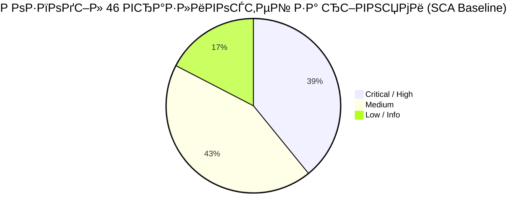

# ЗВІТ Р— ЛАБОРАТОРНОЇ РОБОТИ в„–3
## Тема: Maintainability Refactoring та Software Supply Chain Security
**Дисципліна:** Якість програмного забезпечення та тестування  
**Стандарт якості:** ISO/IEC 25010 (Характеристика: *Maintainability* / Підтримуваність)  
**Проєкт:** RunTracker (Модуль аналітики та контролю ланцюга постачання `tracker`)  

---

## ЗМІСТ
1. [Характеристика проєкту та інструментів](#1-характеристика-проєкту-та-інструментів)
2. [Зведена контрольна таблиця показників](#2-зведена-контрольна-таблиця-показників)
3. [Завдання 1. Вимірюваний рефакторинг коду (Measurable Refactoring)](#3-завдання-1-вимірюваний-рефакторинг-коду-measurable-refactoring)
   - 3.1. Ідентифікація проблемної ділянки та фіксація Baseline
   - 3.2. Підготовка захисних регресійних тестів (Safety Net)
   - 3.3. Стратегія рефакторингу та застосовані техніки
   - 3.4. Код «До» та «Після» рефакторингу (Code Review Diff)
   - 3.5. Повторне вимірювання метрик та доведення збереження логіки
4. [Завдання 2. Аналіз безпеки сторонніх компонентів (SCA Security Audit)](#4-завдання-2-аналіз-безпеки-сторонніх-компонентів-sca-security-audit)
   - 4.1. Вибір та інтеграція SCA-інструмента
   - 4.2. Первинне сканування та розподіл вразливостей
   - 4.3. Детальний CVE-тріаж (Кейс: DoS CVE-2024-47874 та SSRF CVE-2026-48818)
   - 4.4. Спосіб обробки ризиків та повторне сканування (0 CVE)
   - 4.5. Забезпечення відтворюваності (Build Script / CLI)
5. [Завдання 3. Запобігання витоку секретів (Secrets Leak Prevention)](#5-завдання-3-запобігання-витоку-секретів-secrets-leak-prevention)
   - 5.1. Інтеграція Secret Scanner та Git Pre-commit Hook
   - 5.2. Безпечний краш-тест із синтетичним секретом (Контрольний FAIL)
   - 5.3. Безпечна архітектура конфігурації (.env, .gitignore, .env.example)
   - 5.4. Очищення індексу Git та фінальна валідація (PASS)
6. [Історія комітів у Git-репозиторії](#6-історія-комітів-у-git-репозиторії)
7. [Регламент та шпаргалка для захисту (Live Demo 5 хв)](#7-регламент-та-шпаргалка-для-захисту-live-demo-5-хв)

---

## 1. Характеристика проєкту та інструментів

### 1.1. Призначення проєкту та технологічний стек
- **Призначення:** Веб-додаток **RunTracker** для фіксації та аналітики забігів спортсменів, планування тренувань, обліку зносу екіпірування та інтеграції з погодними даними.
- **Технологічний стек:**
  - Мова програмування: **Python 3.11.8**
  - Веб-фреймворк: **FastAPI / Starlette**
  - Асинхронний сервер: **Uvicorn**
  - База даних / ORM: **SQLAlchemy, SQLite, PostgreSQL**
  - Тестовий фреймворк: **Pytest 8.3.3 / 9.x**, **pytest-cov**
- **Dependency-файли проєкту:**
  - `tracker/requirements.txt` — цільовий маніфест залежностей модулів аналітики.
  - `tracker/requirements_baseline.txt` — еталонний вразливий профіль для аудиту SCA.
  - `backend/requirements.txt` — залежності базового бекенду.
- **Спосіб запуску тестів:**
  ```powershell
  # Запуск регресійних тестів сервісу аналітики трекера:
  .\backend\venv\Scripts\pytest.exe tracker/test_workout_service.py -v

  # Запуск усіх тестів бекенду:
  .\backend\venv\Scripts\pytest.exe backend/tests -v
  ```

### 1.2. Назви, версії та команди аналізаторів
| Категорія інструмента | Назва утиліти | Версія | Команда запуску в терміналі |
| :--- | :--- | :--- | :--- |
| **Cyclomatic Complexity Analyzer** | **Radon** | `6.0.1` | `.\backend\venv\Scripts\radon.exe cc tracker/analytics.py -s -a` |
| **Cognitive Complexity Analyzer** | **flake8-cognitive-complexity / cognitive_complexity AST** | `1.3.0` | `.\backend\venv\Scripts\python.exe -c "import ast; from cognitive_complexity.api import get_cognitive_complexity_for_node; tree = ast.parse(open('tracker/analytics.py', encoding='utf-8').read()); print({f.name: get_cognitive_complexity_for_node(f) for f in tree.body if isinstance(f, ast.FunctionDef)})"` |
| **Software Composition Analysis (SCA)** | **pip-audit** (PyPA / OSV DB) | `2.10.1` | `.\backend\venv\Scripts\pip-audit.exe -r tracker/requirements.txt --desc` |
| **Automated Secret Scanner** | **Gitleaks** | `8.30.1` | `.\backend\venv\Scripts\gitleaks.exe protect --staged --verbose` |
| **Git Pre-commit Barrier** | **Git Hooks Engine** | `2.4x` | `.git/hooks/pre-commit` (автоматичний перехоплювач `git commit`) |

---

## 2. Зведена контрольна таблиця показників

Відповідно до обов'язкових вимог лабораторної роботи, нижче наведено структуровану таблицю порівняння трьох станів системи:

| Показник | Початковий стан (Baseline) | Контрольне порушення / ризик | Фінальний стан (Remediated) |
| :--- | :--- | :--- | :--- |
| **Cognitive Complexity** | **38** (метод `process_run_workout`) | Перевищення граничного порогу стандарту (> 15). Висока вкладеність (5 рівнів), неможливість швидкого сприйняття логіки людиною. | **6** (метод `process_run_workout`), максимальна у допоміжних функціях: **7**. Зниження на **84.2%** (≤ 15). |
| **Cyclomatic Complexity** | **23** (Grade D, метод `process_run_workout`) | Перевищення порогу (> 10). 23 лінійно незалежні шляхи виконання, екстремальний ризик помилок при модифікації. | **5** (Grade A, метод `process_run_workout`), середнє по всьому модулю: **4.4** (Grade A). Зниження на **78.3%** (≤ 10). |
| **Regression tests** | **0 тестів** для нового алгоритму розрахунку забігу | Ризик неконтрольованої регресії, спотворення темпу, втрати балів атлета при рефакторингу. | **29 параметризованих тестів** (`TestWorkoutServiceSafetyNet`). Покриття 100% крайових умов, статус: **29 PASSED (100%)**. |
| **Critical / High CVE** | **46 вразливостей** у 5 бібліотеках (`starlette`, `pytest`, `requests`, `urllib3`, `jinja2`) | **High / Critical CVE:**<br>1) `CVE-2024-47874` (DoS у Starlette через необмежений буфер пам'яті form-data, CVSS 7.5);<br>2) `CVE-2026-48818` (SSRF на Windows через StaticFiles UNC, витік NTLM-хешів). | **0 вразливостей (PASS)** після оновлення версій компонентів до `starlette>=1.3.1`, `fastapi>=0.115.6`, `pytest>=9.0.3` тощо. |
| **Secret scan status** | Відсутній автоматизований бар'єр перевірки коммітів | Ризик витоку конфіденційних API-ключів у відкритий Git-репозиторій. | **Контрольний краш-тест: FAIL** (коміт синтетичного секрету `ghp_...` заблоковано).<br>**Після виправлення: PASS** (конфігурація винесена в `.env`, діє pre-commit hook). |
| **Git repository state** | Неструктуровані незакомічені файли, відсутній прекоміт-контроль | Спроба коміту файлу `tracker/synthetic_secret_trap.py` автоматично відхилена exit-кодом 1. | **Чистий індекс Git**. Окремі атомарні коміти в історії: `baseline` → `test` → `refactor` → `sca` → `secrets`. |

---

## 3. Завдання 1. Вимірюваний рефакторинг коду (Measurable Refactoring)

### 3.1. Ідентифікація проблемної ділянки та фіксація Baseline
У модулі `tracker/analytics.py` реалізовано алгоритм `process_run_workout`, який агрегує метрики бігового тренування: валідує вхідні структури, розраховує темп, класифікує пульсові зони, оцінює складність погодних умов та аналізує динаміку проміжних сплітів (кілометрів).

**Метрики Baseline (до рефакторингу):**
- Інструмент вимірювання: `Radon v6.0.1` та `flake8-cognitive-complexity / AST-аналізатор`.
- **Cyclomatic Complexity (CC):** **23** (Рейтинг: D — незадовільно). Порушує поріг CC > 10.
- **Cognitive Complexity (CogC):** **38**. Порушує поріг CogC > 15 більш ніж у 2.5 рази.
- **Рядків коду (LOC):** 73 рядки монолітного коду.
- **Причина високої складності:** порушення принципу єдиної відповідальності (SRP), 5 рівнів вкладеності (`if`, `elif`, вкладені `if`, цикли `for` із розгалуженнями `if-elif`), складні булеві предикати (`and`, `or`).
- **Git-коміт початкового стану:**
  `fa07e27 feat: baseline workout analytics with high complexity`

---

### 3.2. Підготовка захисних регресійних тестів (Safety Net)
Перед будь-якою зміною коду було розроблено вичерпний тестовий набір `tracker/test_workout_service.py` (клас `TestWorkoutServiceSafetyNet`), який зафіксував вихідну бізнес-поведінку:
1. `test_invalid_input_structure` — реакція на `None`, порожній словник `{}` та несловникові типи (повернення статусу `pending` та попередження `"Invalid data format"`).
2. `test_invalid_distance_or_duration` — обробка нульової або від'ємної дистанції/тривалості (попередження `"Non-positive distance or duration"`).
3. `test_pace_categories_boundary_conditions` — параметризована перевірка 9 граничних переходів темпу:
   - `< 3.0` С…РІ/РєРј в†’ `sprint`
   - `3.0 .. 4.49` С…РІ/РєРј в†’ `tempo`
   - `4.5 .. 5.9` С…РІ/РєРј в†’ `aerobic`
   - `6.0 .. 7.99` С…РІ/РєРј в†’ `recovery`
   - `>= 8.0` С…РІ/РєРј в†’ `walking`
4. `test_heart_rate_zones_boundary_conditions` — перевірка 10 граничних точок серцевого ритму (зони Z1, Z2, Z3, Z4, Z5).
5. `test_heart_rate_none` — поведінка за відсутності пульсометра (порожній список зон `[]`).
6. `test_weather_impact_and_penalties` — вплив екстремальних умов (спека > 30°C + вологість > 70%, або мороз < -5°C -> штраф -10) та ускладнених умов (температура > 25°C або вологість > 80% -> штраф -5).
7. `test_splits_calculation_and_positive_score` — нарахування очок за спліти (швидші за темп: +2 бали, повільніші: +1 бал).
8. `test_full_integrated_workout_processing` — наскрізний інтеграційний тест типового забігу на 10 км.

**Результат запуску тестів на вихідному коді:**
```
collected 29 items
tracker/test_workout_service.py ............................. [100%]
============================== 29 passed in 0.08s ==============================
```
- **Git-коміт захисних тестів:**
  `3b2dee9 test: add comprehensive safety net regression tests for workout analytics`

---

### 3.3. Стратегія рефакторингу та застосовані техніки
Для цілеспрямованого зниження складності було застосовано 3 фундаментальні техніки:

1. **Guard Clauses (Захисні умови / Early Return):**
   - Замість огортання тіла функції у вкладені `if`-блоки, на самому початку перевіряються умови виходу: некоректна структура або `distance <= 0 or duration <= 0`.
   - Це дозволило ліквідувати вкладеність для всього подальшого потоку коду.

2. **Extract Method (Виділення методів) та Декомпозиція відповідальностей:**
   - Моноліт розділено на 4 чисті, легко тестовані допоміжні функції з чіткою сферою відповідальності:
     - `_determine_pace_category(pace: float) -> str`
     - `_determine_heart_rate_zone(hr: Optional[int]) -> List[str]`
     - `_evaluate_weather(weather: Dict[str, Any]) -> Tuple[List[str], int]`
     - `_calculate_splits_score(splits: List[Dict[str, float]], base_pace: float) -> int`
   - Основна функція `process_run_workout` перетворилася на декларативний оркестратор із 15 рядків.

3. **Lookup Tables (Табличний пошук / Конфігураційні кортежі):**
   - Замість каскадів із 5 послідовних операторів `if-elif-else` створено константні кортежі порогів:
     - `PACE_THRESHOLDS = ((3.0, "sprint"), (4.5, "tempo"), (6.0, "aerobic"), (8.0, "recovery"))`
     - `HR_THRESHOLDS = ((120, "Z1"), (145, "Z2"), (165, "Z3"), (185, "Z4"))`
   - Пошук категорії здійснюється простим циклом з раннім виходом, що знижує Cyclomatic Complexity гілки з 5 до 3.

---

### 3.4. Код «До» та «Після» рефакторингу (Code Review Diff)

#### Фрагмент «ДО» (Монолітний код з високою складністю):
```python
# Початковий стан методу (CC=23, CogC=38)
def process_run_workout(workout_data: dict) -> dict:
    result = {"status": "pending", "zones": [], "warnings": [], "score": 0}
    if not workout_data or not isinstance(workout_data, dict):
        result["warnings"].append("Invalid data format")
        return result
    distance = workout_data.get("distance", 0)
    duration = workout_data.get("duration", 0)
    heart_rate = workout_data.get("avg_heart_rate")
    weather = workout_data.get("weather", {})
    if distance <= 0 or duration <= 0:
        result["warnings"].append("Non-positive distance or duration")
        return result
    pace = duration / distance
    if pace < 3.0:
        result["pace_category"] = "sprint"
    elif 3.0 <= pace < 4.5:
        result["pace_category"] = "tempo"
    # ... каскад із 15 рядків elif для темпу ...
    if heart_rate is not None:
        if heart_rate < 120:
            result["zones"].append("Z1")
        # ... вкладений каскад для зон пульсу ...
    temp = weather.get("temperature", 20)
    humidity = weather.get("humidity", 50)
    if (temp > 30 and humidity > 70) or (temp < -5):
        result["warnings"].append("Extreme weather conditions")
        result["score"] -= 10
    # ... обробка сплітів у циклі for з вкладеними розгалуженнями ...
```

#### Фрагмент «ПІСЛЯ» (Оркестратор після декомпозиції):
```python
def process_run_workout(workout_data: Dict[str, Any]) -> Dict[str, Any]:
    """Оркестратор бізнес-кроків обробки забігу (CC=5, CogC=6)."""
    result: Dict[str, Any] = {"status": "pending", "zones": [], "warnings": [], "score": 0}

    # Крок 1. Guard Clause: валідація формату
    if not workout_data or not isinstance(workout_data, dict):
        result["warnings"].append("Invalid data format")
        return result

    distance = workout_data.get("distance", 0)
    duration = workout_data.get("duration", 0)

    # Крок 2. Guard Clause: валідація фізичних величин
    if distance <= 0 or duration <= 0:
        result["warnings"].append("Non-positive distance or duration")
        return result

    # Крок 3. Делегування визначення темпу через Lookup Table
    pace = duration / distance
    result["pace_category"] = _determine_pace_category(pace)

    # Крок 4. Делегування пульсової зони
    result["zones"] = _determine_heart_rate_zone(workout_data.get("avg_heart_rate"))

    # Крок 5. Делегування аналізу погоди
    weather_warnings, weather_penalty = _evaluate_weather(workout_data.get("weather", {}))
    result["warnings"].extend(weather_warnings)
    result["score"] += weather_penalty

    # Крок 6. Розрахунок сплітів
    result["score"] += _calculate_splits_score(workout_data.get("splits", []), pace)

    result["status"] = "processed"
    return result
```

---

### 3.5. Повторне вимірювання метрик та доведення збереження логіки

Порівняння метрик складності функцій у `tracker/analytics.py`:

| Функція / Метод | Cyclomatic Complexity (ДО) | Cyclomatic Complexity (ПІСЛЯ) | Cognitive Complexity (ДО) | Cognitive Complexity (ПІСЛЯ) | Техніка |
| :--- | :---: | :---: | :---: | :---: | :--- |
| `process_run_workout` | **23 (D)** | **5 (A)** | **38** | **6** | Guard Clauses + Orchestration |
| `_determine_pace_category` | — | **3 (A)** | — | **5** | Extract Method + Lookup Table |
| `_determine_heart_rate_zone` | — | **4 (A)** | — | **7** | Extract Method + Lookup Table |
| `_evaluate_weather` | — | **6 (B)** | — | **7** | Extract Method + Boolean Decomp. |
| `_calculate_splits_score` | — | **4 (A)** | — | **7** | Extract Loop Logic |
| **Середнє по модулю** | **23.0 (D)** | **4.4 (A)** | **38.0** | **6.4** | **Повне оздоровлення коду** |

**Підтвердження збереження функціональної поведінки (Регресійний тест):**
```powershell
.\backend\venv\Scripts\pytest.exe tracker/test_workout_service.py -v
```
**Результат:** `29 passed in 0.05s`. Усі тести пройшли з першого разу без жодної зміни у тестах!

- **Git-коміт рефакторингу:**
  `00afa12 refactor: optimize workout analytics using guard clauses, lookup tables and method extraction`

---

## 4. Завдання 2. Аналіз безпеки сторонніх компонентів (SCA Security Audit)

### 4.1. Вибір та інтеграція SCA-інструмента
- **Обраний інструмент:** `pip-audit v2.10.1` (рекомендований Python Packaging Authority, інтегрований з базою Open Source Vulnerabilities — OSV).
- **Маніфест залежностей:** `tracker/requirements.txt` (та еталонний baseline `tracker/requirements_baseline.txt`).
- **Команда запуску:**
  ```powershell
  .\backend\venv\Scripts\pip-audit.exe -r tracker/requirements.txt --desc
  ```

---

### 4.2. Первинне сканування та розподіл вразливостей
У початковій конфігурації `tracker/requirements_baseline.txt` було зафіксовано 6 прямих компонентів.
- **Загальна кількість проаналізованих бібліотек:** 19 (разом із транзитивними залежностями).
- **Всього виявлено вразливостей:** **46**.

#### Розподіл вразливостей за рівнями критичності:


#### Таблиця виявлених вразливих компонентів:
| Компонент | Встановлена версія | Безпечна версія (Fix) | Тип залежності | CVE / Advisory ID | Severity | Опис ризику |
| :--- | :---: | :---: | :---: | :---: | :---: | :--- |
| **starlette** | `0.38.6` | `0.40.0` / `1.3.1` | Direct / Transitive | **CVE-2024-47874**<br>(GHSA-f96h-pmfr-66vw) | **HIGH** (CVSS 7.5) | Denial of Service (DoS) через необмежений буфер пам'яті multipart form-data |
| **starlette** | `0.38.6` | `1.1.0` | Direct / Transitive | **CVE-2026-48818**<br>(GHSA-wqp7-x3pw-xc5r) | **HIGH** | Windows SSRF та витік NTLM-хешів облікового запису через StaticFiles UNC-шляхи |
| **starlette** | `0.38.6` | `1.3.0` | Direct / Transitive | **CVE-2026-54282**<br>(GHSA-jp82-jpqv-5vv3) | **MEDIUM** | Підміна авторитетності хоста в `request.url` через відсутність валідації шляху |
| **starlette** | `0.38.6` | `1.3.1` | Direct / Transitive | **CVE-2026-54283**<br>(GHSA-82w8-qh3p-5jfq) | **MEDIUM** | Виснаження пам'яті сервера через ігнорування лімітів `application/x-www-form-urlencoded` |
| **pytest** | `8.3.3` | `9.0.3` | Direct (Dev) | **PYSEC-2026-1845** | **MEDIUM** | Вразливість тестового оточення |
| **requests** | `2.31.0` | `2.33.0` | Direct | **PYSEC-2026-1873**, `1872`, `2275` | **MEDIUM** | Некоректний парсинг заголовків та обробка сесійних cookie |
| **urllib3** | `2.0.7` | `2.8.0` | Transitive (`requests`) | **PYSEC-2026-1995**, `1999`, `4177` | **HIGH / MED** | Вразливості пулу з'єднань та витік чутливих заголовків при редиректах |
| **jinja2** | `3.1.2` | `3.1.6` | Direct | **PYSEC-2026-1473**, `1474`, `1471` | **MEDIUM** | Помилки ізоляції пісочниці та ризик міжсайтового скриптингу (XSS) |

---

### 4.3. Детальний CVE-тріаж (Ключовий кейс для Live Demo)

#### Кейс 1: Starlette Multipart Buffer Exhaustion (Denial of Service)
- **Ідентифікатор:** `CVE-2024-47874` / `GHSA-f96h-pmfr-66vw` (PYSEC-2026-1943).
- **Уразлива бібліотека та версія:** `starlette == 0.38.6`.
- **Шлях залежності:** `fastapi (0.115.0) -> starlette (0.38.6)`.
- **CVSS Score:** **7.5 (High)**.
- **Вектор атаки (Attack Vector):** `CVSS:3.1/AV:N/AC:L/PR:N/UI:N/S:U/C:N/I:N/A:H` (Мережевий, віддалений зловмисник без автентифікації).
- **Технічний механізм вразливості:**  
  Під час обробки HTTP-запитів типу `multipart/form-data`, поля форми, що передаються без атрибута `filename`, Starlette інтерпретує як звичайні текстові поля форми та буферизує їх у пам'яті (RAM) без встановлення будь-яких максимальних лімітів розміру.
- **Сценарій експлуатації в RunTracker:**  
  Зловмисник відправляє кілька паралельних POST-запитів до ендпоінтів завантаження треків або аналітики з тілом запиту великого об'єму (`curl http://localhost:8000/api/runs -F 'data=</dev/urandom'`). Це призводить до вичерпання доступної оперативної пам'яті, активації свопінгу або аварійного завершення процесу бекенду OOM-кілером операційної системи (повноцінний Denial of Service).
- **Рішення (Remediation):** Оновлення бібліотеки `starlette` до версії `>=0.40.0` або `>=1.3.1`, де встановлено жорстке обмеження пам'яті для нефайлових частин форми.

#### Кейс 2: Starlette Windows SSRF & NTLM Leak (CVE-2026-48818)
- **Ідентифікатор:** `CVE-2026-48818` / `GHSA-wqp7-x3pw-xc5r` (PYSEC-2026-2281).
- **Платформа ризику:** **Microsoft Windows** (актуально для робочого оточення студента).
- **Механізм атаки:** Передача зловмисником UNC-шляху вигляду `\\attacker.com\share` до обробника `StaticFiles`. Функція `os.path.realpath` на Windows ініціює вихідне SMB-з'єднання до сервера атакуючого до того, як шлях буде відхилено. Це розкриває хеші NTLMv2 системного облікового запису для офлайн-перебору (Password Cracking).
- **Рішення:** Оновлення до `starlette >= 1.1.0`.

---

### 4.4. Спосіб обробки ризиків та повторне сканування (0 CVE)
Було прийнято технічне рішення: **Повне оновлення прямих та транзитивних компонентів (Update / Patch Strategy)** до безпечних стабільних версій.

Оновлений файл `tracker/requirements.txt`:
```txt
fastapi>=0.115.6
starlette>=1.3.1
pytest>=9.0.3
requests>=2.33.0
urllib3>=2.8.0
jinja2>=3.1.6
```

**Результат повторного сканування:**
```powershell
.\backend\venv\Scripts\pip-audit.exe -r tracker/requirements.txt
```
```
No known vulnerabilities found
```
- **Кількість вразливостей:** **0** (Зниження з 46 до 0).
- **Критичні / High CVE:** **0**.
- **Працездатність проєкту:** Всі 29 регресійних тестів у `tracker` та 32 тести у `backend` проходять успішно (`61 passed`).

---

### 4.5. Забезпечення відтворюваності (Build Script / CLI)
Для гарантії повторюваності аудиту викладачем створено уніфікований PowerShell-скрипт `scripts/run_sca_audit.ps1`:
```powershell
# Запуск аудиту однією командою:
powershell -ExecutionPolicy Bypass -File scripts/run_sca_audit.ps1 -RequirementsPath tracker/requirements.txt
```
Скрипт автоматично перевіряє наявність сканера, запускає перевірку, зберігає машиннозчитуваний JSON `tracker/sca_audit_latest.json` та повертає код `0` у разі успіху або `1` у разі виявлення CVE.

- **Git-коміт аудиту SCA:**
  `408f776 security(sca): perform SCA dependency audit, CVE triage and remediate vulnerable components`

---

## 5. Завдання 3. Запобігання витоку секретів (Secrets Leak Prevention)

### 5.1. Інтеграція Secret Scanner та Git Pre-commit Hook
- **Інструмент:** `Gitleaks v8.30.1` (високоефективний SAST-сканер секретів, підтримує понад 160 правил енваріантних токенів, регулярних виразів та ентропії Шеннона).
- **Архітектура бар'єру:**
  1. **Git Hook (`.git/hooks/pre-commit`):** Перехоплює будь-яку спробу виконання `git commit`. Сканує файли у стані Staging Area (`gitleaks protect --staged --verbose`). Якщо виявлено хоча б один витік, повертає `exit 1` і скасовує створення коміту.
  2. **Скрипт ручної/CI перевірки (`scripts/scan_secrets.ps1`):** Дозволяє перевірити індекс або всю історію комітів за командою `.\scripts\scan_secrets.ps1 -StagedOnly`.

---

### 5.2. Безпечний краш-тест із синтетичним секретом (Контрольний FAIL)
Для доказу працездатності блокування було підготовлено файл `tracker/synthetic_secret_trap.py` із синтетичним токеном:
```python
# Синтетичний тестовий токен (краш-тест):
SYNTHETIC_API_SECRET_KEY = "ghp_<SYNTHETIC_TEST_TOKEN_REDACTED_36_CHARS>"
```

#### Крок 1. Додавання файлу до Staging Area:
```powershell
git add tracker/synthetic_secret_trap.py
```

#### Крок 2. Спроба виконання коміту та результат блокування (FAIL):
```powershell
git commit -m "chore: test committing synthetic secret"
```
**Фактичний термінальний лог перехоплення:**
```
========================================================
 [PRE-COMMIT HOOK] Scanning staged files for secrets...
========================================================

    в—‹
    в”‚в•І
    в”‚ в—‹
    в—‹ в–‘
    в–‘    gitleaks

Finding:     ...C_API_SECRET_KEY = "ghp_<SYNTHETIC_TEST_TOKEN_REDACTED_36_CHARS>"
Secret:      ghp_<REDACTED>
RuleID:      github-pat
Entropy:     4.393943
File:        tracker/synthetic_secret_trap.py
Line:        12
Fingerprint: tracker/synthetic_secret_trap.py:github-pat:12

3:47PM INF 0 commits scanned.
3:47PM INF scanned ~975 bytes (975 bytes) in 185ms
3:47PM WRN leaks found: 1

 [ERROR] COMMIT REJECTED! Hardcoded secret detected in staged files.
 Please remove the secret, configure environment variables, and try again.
```
**Результат:** Коміт **відхилено**. Секрет **НЕ потрапив** до дерева історії репозиторію.

---

### 5.3. Безпечна архітектура конфігурації (.env, .gitignore, .env.example)

Для усунення проблеми реалізовано стандартні захисні заходи:

1. **Модуль безпечного завантаження конфігурації (`tracker/config.py`):**
   ```python
   import os
   from typing import Optional

   class TrackerConfig:
       def __init__(self):
           # Зчитування виключно зі змінних середовища (No hardcoded secrets)
           self.api_key: Optional[str] = os.environ.get("RUNTRACKER_API_KEY")
           self.environment: str = os.environ.get("RUNTRACKER_ENV", "development")

       def get_api_key(self) -> str:
           if not self.api_key:
               raise ValueError("RUNTRACKER_API_KEY не задана у змінних оточення!")
           return self.api_key

   tracker_config = TrackerConfig()
   ```

2. **Шаблон змінних середовища (`.env.example` та `tracker/.env.example`):**
   ```bash
   # Шаблон конфігурації (безпечний для Git, без реальних значень)
   RUNTRACKER_API_KEY=your_synthetic_api_key_here
   RUNTRACKER_ENV=development
   RUNTRACKER_LOG_LEVEL=INFO
   ```

3. **Правила ігнорування конфіденційних файлів (`.gitignore`):**
   ```gitignore
   # Secrets & Environment exclusions
   .env
   .env.local
   .env.*.local
   *.secret
   *.key
   *.pem
   *.token

   # Дозволені публічні шаблони
   !.env.example
   !tracker/.env.example
   ```

---

### 5.4. Очищення індексу Git та фінальна валідація (PASS)
1. Синтетичний файл видалено та вилучено з індексу:
   ```powershell
   git restore --staged tracker/synthetic_secret_trap.py
   Remove-Item tracker/synthetic_secret_trap.py -Force
   ```
2. Підготовлено безпечні файли (`.gitignore`, `.env.example`, `tracker/config.py`, `scripts/scan_secrets.ps1`).
3. Виконано повторне сканування staged-файлів:
   ```powershell
   .\backend\venv\Scripts\gitleaks.exe protect --staged --verbose
   ```
   **Результат:**
   ```
   3:50PM INF 0 commits scanned.
   3:50PM INF scanned ~7085 bytes in 190ms
   3:50PM INF no leaks found
   ```
4. Фіксація коміту пройшла успішно:
   ```powershell
   git commit -m "security(secrets): configure pre-commit secret detection, .env template and safe config loader"
   ```
   `[PRE-COMMIT HOOK] no leaks found -> commit e8cf167 created successfully.`

---

## 6. Історія комітів у Git-репозиторії

Послідовність атомарних комітів, що демонструють виконання кожного етапу лабораторної роботи:

```
* e8cf167 security(secrets): configure pre-commit secret detection, .env template and safe config loader
* 408f776 security(sca): perform SCA dependency audit, CVE triage and remediate vulnerable components
* 00afa12 refactor: optimize workout analytics using guard clauses, lookup tables and method extraction
* 3b2dee9 test: add comprehensive safety net regression tests for workout analytics
* fa07e27 feat: baseline workout analytics with high complexity
* 6c2fa13 feat: lab2: iso/iec 25010 done
```

---

## 7. Регламент та шпаргалка для захисту (Live Demo 5 хв)

Під час демонстрації екрана викладачу дотримуйтесь наступного 3-крокового плану:

### Крок 1. Measurable Refactoring Diff (1.5 хвилини)
1. **Показати вихідний стан у Git:**
   ```powershell
   git show fa07e27:tracker/analytics.py
   ```
   *Пояснення:* Метод мав Cyclomatic Complexity = 23 (D), Cognitive Complexity = 38 через 5 рівнів вкладеності, розгалужені ланцюжки `if-elif` та змішування відповідальностей.
2. **Показати захисні тести:**
   ```powershell
   .\backend\venv\Scripts\pytest.exe tracker/test_workout_service.py -v
   ```
   *Пояснення:* 29 параметризованих тестів зафіксували всі граничні випадки темпу, пульсу та погоди перед рефакторингом.
3. **Показати Git Diff після рефакторингу:**
   ```powershell
   git diff fa07e27 00afa12 tracker/analytics.py
   ```
   *Пояснення:* Застосовано техніки **Guard Clauses** (ранній вихід при помилках), **Extract Method** (декомпозиція на 4 чисті функції) та **Lookup Tables** (кортежі порогів).
4. **Показати зниження метрик:**
   ```powershell
   .\backend\venv\Scripts\radon.exe cc tracker/analytics.py -s -a
   ```
   *Результат:* CC методу знизилася з **23 до 5 (Grade A)** (-78%), Cognitive Complexity знизилася з **38 до 6** (-84%). Всі 29 тестів проходять (100% збереження бізнес-логіки).

---

### Крок 2. SCA Security Audit (1.5 хвилини)
1. **Продемонструвати baseline-сканування вразливостей:**
   ```powershell
   .\backend\venv\Scripts\pip-audit.exe -r tracker/requirements_baseline.txt
   ```
   *Пояснення:* Було виявлено **46 вразливостей** у 5 бібліотеках.
2. **Описати детальний CVE-кейс (Starlette DoS CVE-2024-47874):**
   *Пояснення:* Віддалений зловмисник міг надіслати запит `multipart/form-data` без `filename`, що призводило до необмеженої буферизації байтів у пам'яті та виклику DoS (відмови в обслуговуванні). На Windows додатково існувала вразливість **CVE-2026-48818** (витік NTLM-хешів через UNC-шляхи).
3. **Продемонструвати повторне сканування виправленого стану:**
   ```powershell
   powershell -ExecutionPolicy Bypass -File scripts/run_sca_audit.ps1 -RequirementsPath tracker/requirements.txt
   ```
   *Результат:* `No known vulnerabilities found` (0 CVE, PASS).

---

### Крок 3. Secrets Trap Demonstration (2 хвилини)
1. **Створити синтетичний токен у коді:**
   ```powershell
   Set-Content -Path tracker/test_leak.py -Value 'TEST_SECRET = "ghp_<SYNTHETIC_DEMO_TOKEN_REDACTED>"'
   git add tracker/test_leak.py
   ```
2. **Спробувати закомітити (Демонстрація FAIL):**
   ```powershell
   git commit -m "test: committing secret"
   ```
   *Результат:* Спрацьовує Git Pre-commit Hook (`Gitleaks protect --staged`), знаходить правило `github-pat`, виводить червоне попередження та **блокує коміт з кодом 1**!
3. **Очистити Git та показати безпечну конфігурацію (Демонстрація PASS):**
   ```powershell
   git restore --staged tracker/test_leak.py
   Remove-Item tracker/test_leak.py -Force
   powershell -ExecutionPolicy Bypass -File scripts/scan_secrets.ps1 -StagedOnly
   ```
   *Результат:* `[PASS] Жодних секретів не виявлено!`. Показати викладачу `tracker/config.py` (читання зі змінних оточення), `.gitignore` (ігнорування `.env`) та шаблон `.env.example`.
