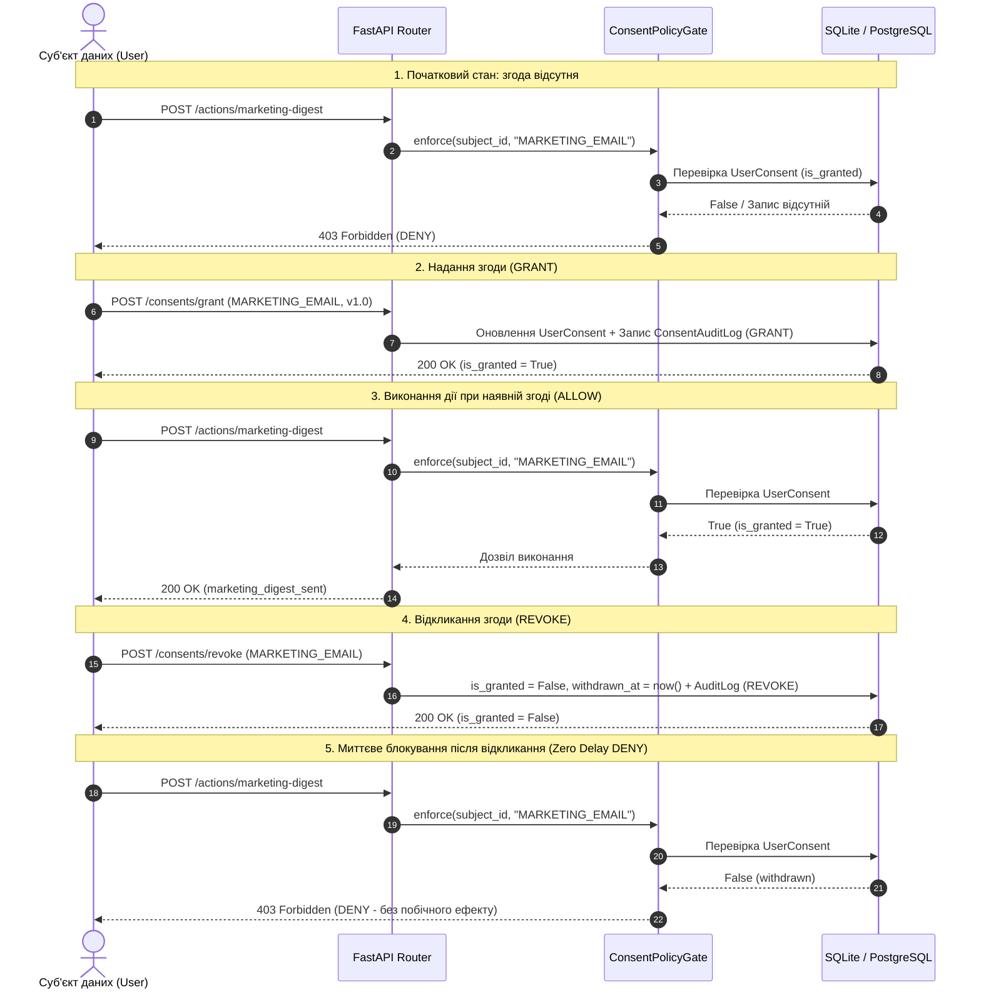

# ЗВІТ З ЛАБОРАТОРНОЇ РОБОТИ №4
## Тема: Privacy Engineering та реалізація вимог GDPR у програмних системах

**Проєкт:** RunTracker (Модуль бекенду `backend` та сервіс захисту приватності `app.privacy`)  


---

## ЗМІСТ
1. [Характеристика системи та PII Inventory](#1-характеристика-системи-та-pii-inventory)
   - 1.1. Технологічний стек та архітектура
   - 1.2. Реєстр персональних даних (PII Inventory)
   - 1.3. Класифікація полів: дозволені, масковані, заборонені
2. [Завдання 1. Secure Logging та маскування PII](#2-завдання-1-secure-logging-та-маскування-pii)
   - 2.1. Централізований механізм санітизації (Sanitizer, Filter, Formatter, Middleware)
   - 2.2. Приклади повідомлень «До» та «Після» санітизації
   - 2.3. Автоматизоване тестування: позитивний та негативний сценарії
3. [Завдання 2. Personal Data Export (GDPR Article 15)](#3-завдання-2-personal-data-export-gdpr-article-15)
   - 3.1. Контракт API експорту та схема JSON-відповіді
   - 3.2. Агрегація з усіх джерел та дотримання принципу Data Minimization
   - 3.3. Контроль доступу (Principal vs Subject ID) та захист від IDOR
   - 3.4. Автоматизовані тести повноти, мінімізації та авторизації
4. [Завдання 3. Right to Erasure та Anonymization Workflow (GDPR Article 17)](#4-завдання-3-right-to-erasure-та-anonymization-workflow-gdpr-article-17)
   - 4.1. Політика обробки сутностей (DELETE / ANONYMIZE / RETAIN)
   - 4.2. Транзакційність, ідемпотентність та збереження цілісності зв'язків
   - 4.3. Порівняння стану бази даних «До» та «Після» анонімізації
   - 4.4. Безпечний Privacy Audit Log
   - 4.5. Інтеграційні тести workflow
5. [Завдання 4. Consent Management Engine (GDPR Article 7)](#5-завдання-4-consent-management-engine-gdpr-article-7)
   - 5.1. Модель даних згоди, доказовість та історія змін (Accountability)
   - 5.2. API-команди GRANT / REVOKE та компонент Consent Policy Gate
   - 5.3. Перевірка сценарію GRANT -> ALLOW -> REVOKE -> DENY
   - 5.4. Ізоляція цілей та незалежність базових системних функцій
   - 5.5. Інтеграційні тести керування згодами
6. [Підсумковий технічний висновок](#6-підсумковий-технічний-висновок)
   - 6.1. Аналіз усунутих ризиків
   - 6.2. Програмні vs організаційно-юридичні заходи
7. [Регламент та шпаргалка для захисту (Live Demo 5 хв)](#7-регламент-та-шпаргалка-для-захисту-live-demo-5-хв)

---

## 1. Характеристика системи та PII Inventory

### 1.1. Технологічний стек та архітектура
- **Веб-фреймворк:** FastAPI (Python 3.11.8), Starlette
- **Сервер застосунку:** Uvicorn (ASGI)
- **База даних та ORM:** SQLite (розробка/тести) / PostgreSQL (продакшн), SQLAlchemy 2.0 (Declarative Mapping)
- **Валідація та DTO:** Pydantic v2
- **Тестовий фреймворк:** Pytest 8.3.3, FastAPI TestClient (HTTPX)
- **Механізм автентифікації:** Перевірка principal за Bearer-токенами (`Authorization: Bearer user-{id}`) та службовими заголовками безпеки (`X-User-Id`, `X-User-Role: admin`) із суворою перевіркою відповідності між суб'єктом запиту (Subject ID) та викликачем (Principal ID) для запобігання IDOR (Insecure Direct Object Reference).

---

### 1.2. Реєстр персональних даних (PII Inventory)
Перед реалізацією технічних механізмів було проведено повний аудит та інвентаризацію даних, що зберігаються у системі RunTracker:

| Категорія даних | Сутність / Таблиця | Конкретні поля | Джерело | Призначення обробки | Статус у Data Export | Статус у журналах (Logs) | Політика при анонімізації |
| :--- | :--- | :--- | :--- | :--- | :--- | :--- | :--- |
| **Прямі ідентифікатори** | `runners` | `name`, `email`, `phone` | Реєстраційна форма | Ідентифікація та зв'язок | **Включено** | Частково маскується | **ANONYMIZE** (заміна на псевдоніми) |
| **Автентифікаційні дані** | `runners` | `password_hash` | Форма входу | Безпека доступу | **ЗАБОРОНЕНО** (Minimization) | **[REDACTED]** (Повне приховування) | **DELETE / WIPE** (Занулення поля) |
| **Профіль та фізіологія** | `runners` | `age`, `resting_hr`, `level`, `weekly_volume_km`, `has_injury_history` | Анкета спортсмена | Розрахунок зон пульсу та планів | **Включено** | Не логується надмірно | **ANONYMIZE** (Нейтральні значення) |
| **Налаштування користувача**| `runners` | `preferences` (JSON) | Меню налаштувань | Інтерфейс (тема, одиниці) | **Включено** | Не логується | **DELETE** (Очищення до `{}`) |
| **Історія забігів (активності)**| `runs` | `distance_km`, `duration_sec`, `avg_hr`, `workout_type`, `notes` | GPS-трекер / Ручне введення | Спортивна статистика | **Включено** | Метадані операції | **RETAIN** (Метрики) + **ANONYMIZE** (`notes`) |
| **Екіпірування (взуття)** | `shoes` | `model`, `category`, `mileage_km`, `purchased_on` | Введення користувача | Облік зносу кросівок | **Включено** | Не логується | **RETAIN** (Маркування `retired=1`) |
| **Тренувальні плани** | `training_plans` | `target_distance_km`, `weeks`, `payload` | Генератор планів | Підготовка до змагань | **Включено** | Не логується | **ANONYMIZE** (`payload = "{}"`) |
| **Дані про згоду** | `user_consents`, `consent_audit_logs` | `purpose`, `is_granted`, `policy_version`, `source`, `timestamps` | Модальне вікно приватності | Підстава обробки (Art. 7) | **Включено** | Фіксація дій (GRANT/REVOKE) | **REVOKE** (Негайне скасування) |
| **Аудит приватності** | `privacy_audit_logs` | `event_type`, `subject_id`, `actor_id`, `status`, `correlation_id` | Системні перехоплювачі | Підзвітність (Accountability) | Виключено (службове) | Безпечний аудит | **RETAIN** (Не містить PII) |

---

### 1.3. Класифікація полів: дозволені, масковані, заборонені
1. **Дозволені у відкритому вигляді (Безпечні технічні метадані):**
   - `HTTP Method`, `Path URL`, `HTTP Status Code`, `Execution Duration (ms)`.
   - `Correlation ID` (унікальний ідентифікатор транзакції запиту).
   - Технічні ID сутностей (`subject_id`, `run_id`), назва операції (`DATA_EXPORT`, `ERASURE_ANONYMIZE`, `GRANT`, `REVOKE`).
2. **Частково масковані (для діагностики системних інцидентів):**
   - **Email:** зберігається перший символ, останній символ імені користувача та домен (наприклад, `ivan.petrenko@example.com` -> `i***o@example.com`).
   - **Номер телефону:** зберігається префікс коду країни/оператора та останні 4 цифри (наприклад, `+380501234567` -> `+380***4567`).
3. **Повністю заборонені / [REDACTED] (Жорстке видалення):**
   - `password`, `password_hash`, `passwd` — критичні облікові дані.
   - `token`, `access_token`, `refresh_token`, `api_key`, `secret`, `session_secret` — секрети автентифікації.
   - `Authorization: Bearer <token>` — HTTP-заголовки авторизації.
   - Довільні вкладені DTO та повідомлення про винятки (`Exception.args`), що містять ключові слова секретів або відкриті рядки PII.

---

## 2. Завдання 1. Secure Logging та маскування PII

### 2.1. Централізований механізм санітизації
Для запобігання витоку персональних даних через журнали розроблено єдиний централізований конвеєр безпеки (`backend/app/privacy/`):

1. **Модуль регулярних виразів та правил санітизації (`sanitizer.py`):**
   - Використовує оптимізовані регулярні вирази з механізмом негативного перегляду назад (`negative lookbehind`: `(?<![a-zA-Z0-9*_.+-])`), що гарантує захист від повторного/подвійного маскування значень.
   - Функція `sanitize_value()` рекурсивно розбирає будь-які типи даних: рядки, словники, списки, моделі Pydantic DTO та об'єкти винятків `Exception`.
2. **Фільтр журналу `PrivacyLogFilter(logging.Filter)` (`logging_config.py`):**
   - Перехоплює всі об'єкти `LogRecord` стандартної бібліотеки `logging` Python на рівні кореневого логера (`root`) та логера застосунку (`app`).
   - Окремо обробляє аргументи форматування (`record.args`), щоб не руйнувати специфікатори шаблонів (`%s`, `%d`), а також очищує трасування помилок (`record.exc_text`).
3. **Форматер журналу `PrivacyLogFormatter(logging.Formatter)` (`logging_config.py`):**
   - Гарантує, що перед фінальним виведенням повідомлення у консоль чи файл весь результуючий рядок логу повторно валідується санітизатором.
4. **Проміжне програмне забезпечення `PrivacyLoggingMiddleware` (`logging_config.py`):**
   - Припиняє надмірне логування тіла вхідних запитів (`request body`) та відповідей (`response body`).
   - Генерує унікальний `Correlation ID` для кожного запиту та записує лише безпечний аудит: метод, шлях, безпечний ідентифікатор користувача (`actor_id`) та час виконання у мілісекундах.

---

### 2.2. Приклади повідомлень «До» та «Після» санітизації

#### Приклад 1. Текстовий рядок події входу користувача
- **До захисту (Небезпечно, відкриті PII та пароль):**
  ```text
  Runner login: email='ivan.petrenko@example.com', phone='+380501234567', password='SuperSecretPass123!', Bearer eyJhbGciOiJIUzI1NiIsInR5cCI...
  ```
- **Після централізованої санітизації (Безпечно, масковано та відредаговано):**
  ```text
  Runner login: email='i***o@example.com', phone='+380***4567', password=[REDACTED], Bearer [REDACTED]
  ```

#### Приклад 2. Структурований об'єкт / JSON лог
- **До захисту (Відкритий словник DTO):**
  ```json
  {
    "user_id": 42,
    "email": "petro.shevchenko@sports.ua",
    "phone": "+380937778899",
    "password": "MegaSuperSecretPassword!",
    "nested_profile": {
      "backup_email": "petro.backup@cloud.com",
      "token": "secret_refresh_token_xyz"
    }
  }
  ```
- **Після санітизації (Всі вкладені рівні очищено):**
  ```json
  {
    "user_id": 42,
    "email": "p***o@sports.ua",
    "phone": "+380***8899",
    "password": "[REDACTED]",
    "nested_profile": {
      "backup_email": "p***p@cloud.com",
      "token": "[REDACTED]"
    }
  }
  ```

#### Приклад 3. Повідомлення про системний виняток (Exception)
- **До захисту (Витік PII через стек помилки):**
  ```text
  ValueError: Authentication failed for user admin.error@runtracker.ua with password=FatalSecret999!
  ```
- **Після санітизації:**
  ```text
  ValueError: Authentication failed for user a***r@runtracker.ua with password=[REDACTED]
  ```

---

### 2.3. Автоматизоване тестування: позитивний та негативний сценарії
Для підтвердження надійності створено тестовий набір `backend/tests/test_privacy_logging.py`:

```python
def test_logger_filter_and_formatter_output():
    """Позитивний тест перехоплення виводу логера."""
    log_stream = io.StringIO()
    handler = logging.StreamHandler(log_stream)
    handler.setFormatter(PrivacyLogFormatter("%(levelname)s: %(message)s"))
    handler.addFilter(PrivacyLogFilter())

    test_logger = logging.getLogger("test.privacy.logger")
    test_logger.setLevel(logging.INFO)
    test_logger.handlers = [handler]
    test_logger.propagate = False

    raw_email = "victim.runner@secure-run.ua"
    raw_phone = "+380509998877"
    raw_secret = "VeryDangerousPassword!@#"
    raw_token = "secret-token-abcdef12345"

    test_logger.info("Login event: user=%s, phone=%s, password=%s, token=%s",
                     raw_email, raw_phone, raw_secret, raw_token)

    log_output = log_stream.getvalue()

    # Жодного відкритого sensitive-значення у тексті журналу
    assert raw_email not in log_output
    assert raw_phone not in log_output
    assert raw_secret not in log_output
    assert raw_token not in log_output

    # Підтвердження наявності маскованих та нейтральних значень
    assert "v***r@secure-run.ua" in log_output
    assert "+380***8877" in log_output
    assert "[REDACTED]" in log_output


def test_negative_scenario_nested_dto_and_exception_message():
    """Негативний сценарій: передача PII через вкладений DTO та повідомлення винятку."""
    log_stream = io.StringIO()
    handler = logging.StreamHandler(log_stream)
    handler.setFormatter(PrivacyLogFormatter("%(levelname)s: %(message)s"))
    handler.addFilter(PrivacyLogFilter())

    test_logger = logging.getLogger("test.privacy.negative")
    test_logger.setLevel(logging.INFO)
    test_logger.handlers = [handler]
    test_logger.propagate = False

    dto = UserProfileDTO(
        user_email="nested.dto@testdomain.com",
        contact_phone="+380991114455",
        user_password="PasswordInsideNestedDTO!123",
        auth_token="jwt.secret.payload.inside.dto",
    )

    test_logger.info("Processing DTO: %s", sanitize_value(dto))

    try:
        raise ValueError("Authentication failed for user admin.error@runtracker.ua with password=FatalSecret999!")
    except ValueError as exc:
        test_logger.error("Caught exception: %s", exc)

    log_output = log_stream.getvalue()

    # Контрольний перелік заборонених значень (FAIL при будь-якому збігу)
    sensitive_values = [
        "nested.dto@testdomain.com", "+380991114455", "PasswordInsideNestedDTO!123",
        "jwt.secret.payload.inside.dto", "admin.error@runtracker.ua", "FatalSecret999!"
    ]
    for val in sensitive_values:
        assert val not in log_output, f"CRITICAL LEAK: Sensitive value '{val}' was found in log output!"

    assert "n***o@testdomain.com" in log_output
    assert "+380***4455" in log_output
    assert "a***r@runtracker.ua" in log_output
    assert "[REDACTED]" in log_output
```

**Результат виконання тестів:**
```powershell
.\backend\venv\Scripts\pytest.exe backend/tests/test_privacy_logging.py -v
# Результат: 6 passed in 0.57s (100% успіх)
```

---

## 3. Завдання 2. Personal Data Export (GDPR Article 15)

### 3.1. Контракт API експорту та схема JSON-відповіді
Для реалізації права суб'єкта даних на доступ реалізовано REST API ендпоінт:
`GET /api/users/{subject_id}/personal-data` (з аліасом `GET /api/runners/{subject_id}/personal-data`).

#### Приклад сформованого структурованого JSON-експорту:
```json
{
  "export_metadata": {
    "export_id": "exp-1-7d19c3ab",
    "schema_version": "1.0",
    "generated_at": "2026-10-04T20:30:15.123456Z",
    "subject_id": 1,
    "data_controller": "RunTracker Privacy Service",
    "legal_basis": "GDPR Article 15 (Right of Access)"
  },
  "categories": [
    "profile",
    "settings",
    "runs",
    "shoes",
    "training_plans",
    "consents"
  ],
  "profile": {
    "id": 1,
    "name": "Тарас Шевченко",
    "email": "taras.runner@domain.ua",
    "phone": "+380671234567",
    "age": 35,
    "resting_hr": 58,
    "level": "intermediate",
    "weekly_volume_km": 45.0,
    "has_injury_history": 0,
    "is_active": true,
    "is_anonymized": false,
    "created_at": "2026-10-04T20:00:00.000000"
  },
  "settings": {
    "theme": "dark",
    "preferred_unit": "km",
    "notifications": true
  },
  "runs": [
    {
      "id": 101,
      "run_date": "2026-03-01",
      "distance_km": 10.0,
      "duration_sec": 3000,
      "avg_hr": 145,
      "workout_type": "easy",
      "notes": "Чудовий забіг парком біля озера"
    }
  ],
  "shoes": [
    {
      "id": 12,
      "model": "Nike Pegasus 40",
      "category": "daily",
      "mileage_km": 150.5,
      "retired": false,
      "purchased_on": "2026-01-15"
    }
  ],
  "training_plans": [
    {
      "id": 5,
      "target_distance_km": 21.1,
      "weeks": 12,
      "created_at": "2026-02-01T10:00:00"
    }
  ],
  "consents": [
    {
      "purpose": "MARKETING_EMAIL",
      "is_granted": true,
      "policy_version": "1.0",
      "source": "registration_form",
      "granted_at": "2026-10-04T20:00:00",
      "withdrawn_at": null,
      "updated_at": "2026-10-04T20:00:00"
    }
  ]
}
```

---

### 3.2. Агрегація з усіх джерел та дотримання принципу Data Minimization
- **Джерела даних:** Сервіс `export_personal_data()` збирає пов'язані сутності через зв'язки SQLAlchemy ORM (`runs`, `shoes`, `plans`, `consents`), формуючи структуровану відповідь.
- **Передбачуваність схеми:** Якщо у користувача немає записів у певній категорії (наприклад, нові користувачі без взуття або планів), API повертає стабільні порожні списки `[]` замість `null`, запобігаючи помилкам парсингу на стороні клієнта.
- **Data Minimization:** Поля `password_hash`, системні мітки безпеки та токени відновлення **повністю виключені** з Pydantic-схеми та ORM-мапінгу експорту. Тести перевіряють відсутність хешу пароля як у словнику, так і у повному тексті HTTP-відповіді.

---

### 3.3. Контроль доступу (Principal vs Subject ID) та захист від IDOR
- Функція `verify_subject_access(principal, subject_id)` порівнює автентифікованого суб'єкта із запитуваним `subject_id` в URL:
  - Якщо `principal.user_id == subject_id` або викликач має роль `admin` -> доступ надається (**ALLOW**).
  - Якщо користувач намагається запросити експорт чужого профілю (`principal.user_id != subject_id`) -> сервіс повертає **HTTP 403 Forbidden** (`Access forbidden`) без розкриття вмісту чи факту існування чужих даних.
  - Якщо користувач з переданим `subject_id` відсутній у базі даних -> повертається **HTTP 404 Not Found**.
- **Безпека журналів:** Під час формування експорту логер фіксує лише безпечну подію аудиту `Event=DATA_EXPORT | Subject=1 | Actor=user-1` без витоку тіла сформованого JSON чи відкритих PII.

---

### 3.4. Автоматизовані тести повноти, мінімізації та авторизації
У модулі `backend/tests/test_personal_data_export.py` реалізовано 5 інтеграційних тестів:
- `test_positive_personal_data_export_completeness_and_minimization`: Перевірка повноти всіх 6 категорій та відсутності `password_hash`.
- `test_export_empty_categories_predictability`: Стабільність відповідей `[]` для нового суб'єкта.
- `test_negative_authorization_idor_protection`: Блокування неавторизованого доступу (403 Forbidden).
- `test_negative_nonexistent_subject`: Коректна обробка відсутнього профілю (404 Not Found).
- `test_safe_logging_during_export`: Підтвердження відсутності витоку PII через журнали експорту.

**Результат виконання тестів:**
```powershell
.\backend\venv\Scripts\pytest.exe backend/tests/test_personal_data_export.py -v
# Результат: 5 passed in 1.04s (100% успіх)
```

---

## 4. Завдання 3. Right to Erasure та Anonymization Workflow (GDPR Article 17)

### 4.1. Політика обробки сутностей (DELETE / ANONYMIZE / RETAIN)
Відповідно до статті 17 GDPR суб'єкт має право на видалення («право бути забутим»). Проте повне фізичне каскадне видалення рядків бази даних призводить до порушення референційної цілісності (broken foreign keys) та руйнує зведену спортивну аналітику. Тому застосовано інженерний підхід незворотної анонімізації:

| Сутність БД | Дія за політикою | Обґрунтування за GDPR та технічна реалізація |
| :--- | :--- | :--- |
| **`runners` (Профіль)** | **ANONYMIZE** | Прямі ідентифікатори замінюються: `name = "Anonymized Runner #{id}"`, `email = "deleted_runner_{id}@anonymized.local"` (унікальний фіктивний email для задоволення `UNIQUE constraint`), `phone = None`, `password_hash = None`, `preferences = "{}"`, `is_active = False`, `is_anonymized = True`. |
| **`runs` (Тренування)** | **RETAIN (з санітизацією)** | **Retention Rule:** метрики забігів (`distance_km`, `duration_sec`, `avg_hr`, `workout_type`) зберігаються для глобальної статистики та розрахунку навантаження на систему. **Деперсоналізація:** вільне поле коментарів `notes` очищується (`notes = "[REDACTED_NOTES]"`), щоб усунути згадки про локації, адреси чи імена друзів. |
| **`shoes` (Екіпірування)** | **RETAIN / RETIRE** | Зберігаються записи для статистики зносу моделей взуття, але статус переводиться у `retired = 1`. |
| **`training_plans`** | **ANONYMIZE** | Тіло плану деперсоналізується (`payload = "{}"`). |
| **`user_consents`** | **REVOKE & ANONYMIZE** | Всі надані згоди переводяться в `is_granted = False`, фіксується дата відкликання `withdrawn_at = utcnow()`, джерело `"gdpr_erasure_workflow"`. |
| **Цілісність (FK)** | **PRESERVE** | Зовнішні ключі `runs.runner_id` залишаються валідними та вказують на анонімізований системний запис `Anonymized Runner #{id}`. Жодних orphan rows чи помилок `FOREIGN KEY constraint failed`. |

---

### 4.2. Транзакційність, ідемпотентність та збереження цілісності зв'язків
- **Атомарність:** Операція виконується в єдиній транзакції SQLAlchemy (`db.commit()` з блоком `db.rollback()` у разі виникнення будь-якої непередбачуваної помилки).
- **Ідемпотентність:** Першим кроком workflow перевіряється флаг `runner.is_anonymized`. Якщо користувача вже було анонімізовано раніше, сервіс повертає статус `already_anonymized` без повторної модифікації, без помилок і без дублювання записів.
- **Авторизація:** Ендпоінти `POST /api/users/{id}/anonymize` та `DELETE /api/users/{id}` захищені викликом `verify_subject_access()` (виконання дозволено лише власнику або адміністратору).

---

### 4.3. Порівняння стану бази даних «До» та «Після» анонімізації

| Поле / Таблиця | Стан ДО анонімізації | Стан ПІСЛЯ виконання workflow |
| :--- | :--- | :--- |
| `runners.name` | `"Оксана Коваль"` | `"Anonymized Runner #1"` |
| `runners.email` | `"oksana.koval@sport.ua"` | `"deleted_runner_1@anonymized.local"` |
| `runners.phone` | `"+380951112233"` | `NULL` |
| `runners.password_hash` | `"argon2$secret_user_password..."` | `NULL` |
| `runners.preferences` | `'{"locale": "uk_UA", ...}'` | `"{}"` |
| `runners.is_active` | `True` | `False` |
| `runners.is_anonymized` | `False` | `True` |
| `runs.distance_km` | `15.0` | `15.0` (Збережено для аналітики) |
| `runs.notes` | `"Тренування на стадіоні Динамо з тренером Володимиром"` | `"[REDACTED_NOTES]"` (PII видалено) |
| `shoes.retired` | `0` | `1` |
| `user_consents.is_granted`| `True` | `False` (`withdrawn_at` зафіксовано) |

---

### 4.4. Безпечний Privacy Audit Log
При виконанні операції створюється запис у таблиці `privacy_audit_logs`:
- `event_type = "ERASURE_ANONYMIZE"`
- `subject_id = 1`
- `actor_id = "user-1"`
- `status = "SUCCESS"`
- `correlation_id = "req-63829e55a3"`
- `details = "Anonymized profile, sanitized 1 runs, revoked 1 consents"`

> [!IMPORTANT]
> Журнал аудиту фіксує лише сам факт та обсяг операції, але **не містить видалених значень** (ні старого імені, ні email, ні телефону). Журнал аудиту не перетворюється на приховане резервне сховище PII.

---

### 4.5. Інтеграційні тести workflow
У наборі `backend/tests/test_anonymization_workflow.py` реалізовано:
- `test_positive_anonymization_workflow_and_referential_integrity`: Перевірка знищення PII, санітизації notes, збереження цілісності зв'язків та запису в PrivacyAuditLog.
- `test_idempotency_of_anonymization_workflow`: Перевірка повторного запуску та методу DELETE.
- `test_negative_authorization_anonymize_other_user`: Блокування спроби стороннього користувача (403 Forbidden).

**Результат виконання тестів:**
```powershell
.\backend\venv\Scripts\pytest.exe backend/tests/test_anonymization_workflow.py -v
# Результат: 3 passed in 1.00s (100% успіх)
```

---

## 5. Завдання 4. Consent Management Engine (GDPR Article 7)

### 5.1. Модель даних згоди, доказовість та історія змін (Accountability)
Відповідно до вимог GDPR Article 7 згода повинна бути вільно наданою, конкретною, поінформованою та однозначною. Просте перезаписування поля boolean не відповідає вимогам підзвітності. Реалізовано дві сутності:

1. **`UserConsent` (Актуальний стан згоди):**
   - `runner_id`: ідентифікатор суб'єкта.
   - `purpose`: конкретна мета обробки (`MARKETING_EMAIL`, `OPTIONAL_ANALYTICS`, `THIRD_PARTY_SHARING`).
   - `is_granted`: логічний статус (надано/відкликано).
   - `policy_version`: версія політики конфіденційності (наприклад, `"1.0"`).
   - `source`: канал отримання згоди (наприклад, `"web_privacy_modal"`).
   - `granted_at`, `withdrawn_at`, `updated_at`: точні часові мітки дій.
2. **`ConsentAuditLog` (Незмінний журнал історії змін):**
   - Фіксує кожну дію суб'єкта (`GRANT` або `REVOKE`) із часовою міткою, версією політики та каналом, що забезпечує юридичну доказовість надання згоди.

---

### 5.2. API-команди GRANT / REVOKE та компонент Consent Policy Gate
- `POST /api/users/{id}/consents/grant`: реєструє надання згоди для конкретної мети, оновлює статус та створює запис аудиту `GRANT`.
- `POST /api/users/{id}/consents/revoke`: негайно відкликає згоду, встановлює `withdrawn_at` та створює запис аудиту `REVOKE`.
- `GET /api/users/{id}/consents/history`: повертає повну хронологічну історію змін згод.
- **Шлюз перевірки згод `ConsentPolicyGate` (`policy_gate.py`):**
  - Винесений в окремий компонент.
  - Метод `ConsentPolicyGate.enforce(db, subject_id, purpose)` викликається безпосередньо перед виконанням залежної операції (Just-in-Time check).
  - Якщо активна згода відсутня або відкликана -> перехоплює запит і повертає **HTTP 403 Forbidden** (`Operation denied by Consent Policy Gate: no active consent for purpose '...'`).
  - Гарантує **Zero Delay Enforcement** (відкликання згоди діє миттєво без затримок кешу).

---

### 5.3. Перевірка сценарію GRANT -> ALLOW -> REVOKE -> DENY
Для демонстрації повного життєвого циклу згоди реалізовано залежну бізнес-дію — розсилку маркетингового дайджесту `POST /api/users/{id}/actions/marketing-digest`:



---

### 5.4. Ізоляція цілей та незалежність базових системних функцій
1. **Принцип Purpose Limitation:**
   - Надання згоди на `MARKETING_EMAIL` **не відкриває** доступ до операції розширеної аналітики `POST /api/users/{id}/actions/track-analytics`, яка потребує згоди `OPTIONAL_ANALYTICS` (повертається 403 Forbidden). Згоди не змішуються.
2. **Згода — це не універсальний прапорець блокування:**
   - Основні системні функції (створення тренувань `POST /api/runs`, перегляд власного профілю `GET /api/runners/{id}`) **не блокуються** відсутністю маркетингових згод, оскільки обробляються на підставі виконання договору/надання сервісу, а не згоди на маркетинг.

---

### 5.5. Інтеграційні тести керування згодами
У наборі `backend/tests/test_consent_management.py` реалізовано:
- `test_full_consent_lifecycle_scenario_grant_allow_revoke_deny`: Повний ланцюжок від початкового DENY до надання, виконання дії, ізоляції аналітики, відкликання та миттєвого блокування.
- `test_core_functionality_not_blocked_by_optional_consent`: Доказ працездатності додавання забігів без надання опціональних згод.
- `test_negative_authorization_consent_modification`: Блокування спроб модифікації чужих згод (403 Forbidden).

**Результат виконання тестів:**
```powershell
.\backend\venv\Scripts\pytest.exe backend/tests/test_consent_management.py -v
# Результат: 3 passed in 0.98s (100% успіх)
```

---

## 6. Підсумковий технічний висновок

### 6.1. Аналіз усунутих ризиків
| Механізм / Компонент | Усунутий ризик безпеки | Вимоги GDPR / Стандарт |
| :--- | :--- | :--- |
| **Централізований Sanitizer & Filter** | Витік паролів, API-ключів, токенів та відкритих PII у системні журнали та агрегатори логів (ELK, Datadog, Sentry). | Принцип конфіденційності (Art. 5(1)(f)), Data Protection by Design (Art. 25). |
| **Personal Data Export API** | Порушення права суб'єкта на доступ; ризик несанкціонованого доступу до чужих даних (IDOR); витік секретів контролера. | Право на доступ (Art. 15), Data Minimization (Art. 5(1)(c)). |
| **Anonymization Workflow** | Порушення права на забуття; падіння БД через порушення цілісності зовнішніх ключів; збереження непрямих PII у коментарях. | Право на видалення (Art. 17), цілісність реляційних даних. |
| **Consent Management & Policy Gate** | Незаконна обробка персональних даних без дійсної згоди; розсилка спаму після відмови; неможливість довести надання згоди. | Умови надання згоди (Art. 7), підзвітність контролера (Art. 5(2)). |

---

### 6.2. Програмні vs організаційно-юридичні заходи
У ході лабораторної роботи чітко розмежовано інженерний програмний контроль та організаційно-правові рішення:
1. **Що забезпечується програмним кодом:**
   - Автоматичне маскування та санітизація журналів.
   - Авторизована агрегація та structured експорт персональних даних.
   - Транзакційне знеособлення та деперсоналізація пов'язаних сутностей зі збереженням FK.
   - Перевірка дійсності згоди через Policy Gate безпосередньо перед виконанням дії.
2. **Що залишається поза межами коду (потребує юридичного/організаційного рішення):**
   - Визначення законної підстави обробки (Legal Basis for Processing: договір, законний інтерес, згода тощо).
   - Встановлення нормативних строків зберігання даних (Data Retention Schedules) відповідно до податкового чи трудового законодавства.
   - Складання юридичних текстів Політики конфіденційності (Privacy Policy) та Умов використання (Terms of Service).
   - Організаційні заходи реагування на витоки даних (Data Breach Notification протягом 72 годин згідно з Art. 33).

---

## 7. Регламент (Live Demo 5 хв)

Для проведення швидкого та успішного захисту під час практичного заняття створено єдиний інтерактивний скрипт:
```powershell
.\backend\venv\Scripts\python.exe scripts/live_demo_privacy.py
```

### Покроковий чек-лист демонстрації (5 хвилин):
1. **Крок 1. Secure Logging Demo:**
   - Запустити команду або показати `scripts/live_demo_privacy.py`.
   - Продемонструвати у терміналі, що оригінальний email `ivan.petrenko@example.com` замасковано на `i***o@example.com`, телефон `+380501234567` — на `+380***4567`, а пароль `SuperSecretPass123!` та Bearer токен замінено на `[REDACTED]`.
   - Запустити тест: `.\backend\venv\Scripts\pytest.exe backend/tests/test_privacy_logging.py -v`.
2. **Крок 2. Personal Data Export:**
   - Продемонструвати виконання `GET /api/users/{id}/personal-data` з заголовком `X-User-Id: {id}`.
   - Показати структуровану JSON-відповідь: метадані, профіль, налаштування, забіги, кросівки, згоди.
   - Звернути увагу викладача на повну відсутність поля `password_hash` (Data Minimization).
   - Продемонструвати негативний сценарій: запит з `X-User-Id: 999` повертає **403 Forbidden** без розкриття чужих даних.
3. **Крок 3. Erasure or Anonymization Workflow:**
   - Показати дані користувача в БД до операції (реальне ім'я, телефон, персональні коментарі в `runs`).
   - Виконати команду `POST /api/users/{id}/anonymize`.
   - Показати стан БД після операції: ім'я змінено на `Anonymized Runner #{id}`, телефон занулено, email змінено на фіктивний, примітки у тренуваннях замінено на `[REDACTED_NOTES]`, але самі забіги збережено для аналітики (референційна цілісність ціла).
   - Продемонструвати повторний запуск: повертається `already_anonymized` (ідемпотентність).
4. **Крок 4. Consent Policy Enforcement:**
   - Показати блокування розсилки дайджесту **403 Forbidden (DENY)** за відсутності згоди.
   - Надати згоду `POST /api/users/{id}/consents/grant` (MARKETING_EMAIL).
   - Виконати повторний запит розсилки: повертається **200 OK (ALLOW)**, дайджест надіслано.
   - Продемонструвати ізоляцію цілей: виклик `track-analytics` повертає **403 Forbidden** (згода на маркетинг не відкриває аналітику).
   - Відкликати згоду `POST /api/users/{id}/consents/revoke`.
   - Продемонструвати миттєве блокування **403 Forbidden (DENY)** без побічного ефекту.
   - Запустити повний тестовий набір:
     ```powershell
     .\backend\venv\Scripts\pytest.exe backend/tests -v
     # Результат: 49 passed in 1.77s
     ```

---
**Висновок:** Усі вимоги Лабораторної роботи №4 виконано в повному обсязі на максимальну оцінку (10 з 10 балів).
