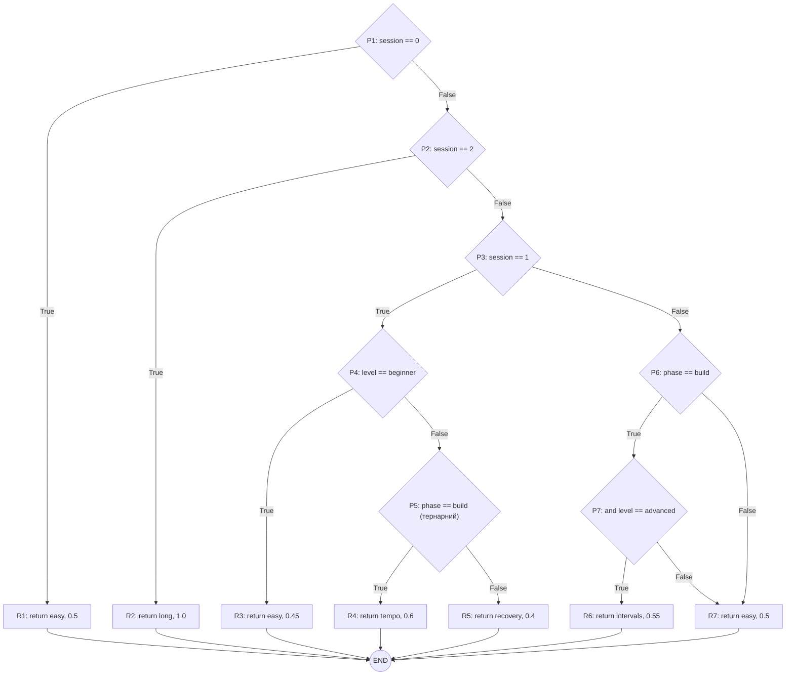
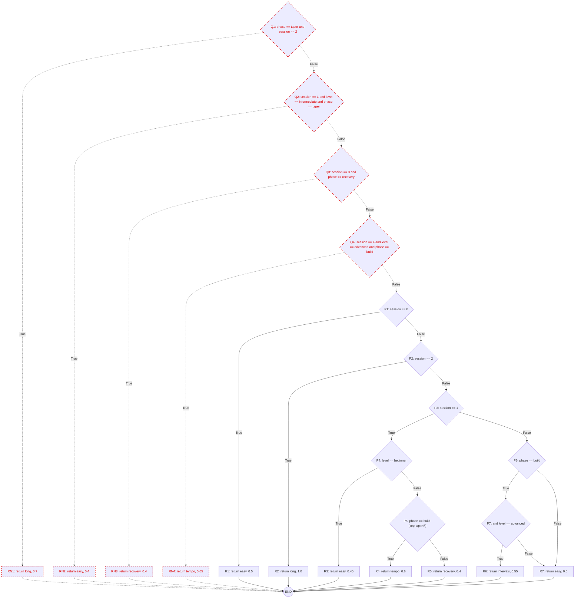

# Лабораторна робота №6
## Топологічний та аналітичний аудит внутрішньої складності алгоритмів (метрики Холстеда та Мак-Кейба)

**Проєкт:** RunTracker (Python / FastAPI) · **Гілка:** `metrics_lab6`

---

# Завдання 1. Первинний аналітичний скринінг репозиторію за Холстедом

## 1.1 Декларація інструментального стеку

| Параметр | Значення |
|---|---|
| Інструмент | **Radon** — Python static code metrics tool (Halstead, McCabe CC, Raw metrics, MI) |
| Версія | **6.0.1** (`radon --version`) |
| Інсталяція | `pip install radon` |
| Метрики Холстеда | `radon hal <шлях>` (`-f` — по функціях, `-j` — JSON) |
| Рядки коду | `radon raw <шлях>` |
| Конфігурація | `./radon.cfg` |

Вміст `radon.cfg` (виключаємо тести та тимчасові копії файлів):
```ini
[radon]
exclude = *test_*,*tests*,*analytics_crlf.py,*analytics_lf.py
```

> **Особливість Radon:** операторами вважаються лише операції AST (`+ - * / ** % < > <= >= == != and or not in is |` тощо),
> операндами — їхні аргументи. Ключові слова (`if`, `for`, `return`) та роздільники не враховуються.
> Тому файли без обчислень (`config.py`, `database.py`, `__init__.py`, `report_export_*.py`) мають нульові метрики —
> це підтверджує, що інструмент вимірює саме алгоритмічну складність, а не обсяг тексту.

## 1.2 Глобальна базова лінія (Global Baseline Scan)

```powershell
radon hal backend/app tracker                          # скріншот
radon hal backend/app tracker -j -O hal_baseline.json
python scripts/hal_total.py
```

Вивід `hal_total.py`:
```
files=30 h1=112 h2=346 N1=249 N2=467
vocabulary=458 length=716 V=6328.87 D=75.58 E=478360.13
```

| Метрика | Значення |
|---|---|
| Проскановано файлів | 30 |
| η₁ — унікальні оператори | 112 |
| η₂ — унікальні операнди | 346 |
| N₁ — усього операторів | 249 |
| N₂ — усього операндів | 467 |
| **η = η₁ + η₂ (словник)** | **458** |
| **N = N₁ + N₂ (довжина)** | **716** |

> η₁ та η₂ проєкту отримано сумою по файлах (Radon не має загального звіту), тож це наближення:
> однаковий оператор у різних файлах рахується як окремий унікальний.

## 1.3 Матриця архітектурного поштучного аналізу

Формули:
- η = η₁ + η₂
- N = N₁ + N₂
- V = N × log₂(η)
- D = (η₁ / 2) × (N₂ / η₂)
- E = V × D

| Файл | Роль | LOC | SLOC | η₁ | η₂ | N₁ | N₂ | η | N | V | D | E |
|---|---|---|---|---|---|---|---|---|---|---|---|---|
| `backend/app/services/plans.py` | Core Domain | 106 | 74 | 10 | 38 | 25 | 49 | 48 | 74 | 413.29 | 6.45 | **2664.62** |
| `backend/app/services/weather_client.py` | Integration | 47 | 32 | 6 | 9 | 6 | 12 | 15 | 18 | 70.32 | 4.00 | **281.30** |
| `backend/app/schemas.py` | DTO | 228 | 160 | 1 | 7 | 17 | 34 | 8 | 51 | 153.00 | 2.43 | **371.57** |

Ручна верифікація:

**plans.py:**
```
η = 10 + 38 = 48;   N = 25 + 49 = 74
V = 74 × log₂(48) = 74 × 5.585 = 413.29
D = (10/2) × (49/38) = 5 × 1.2895 = 6.447
E = 413.29 × 6.447 = 2664.62
```
**weather_client.py:**
```
η = 6 + 9 = 15;   N = 6 + 12 = 18
V = 18 × log₂(15) = 18 × 3.907 = 70.32
D = (6/2) × (12/9) = 3 × 1.333 = 4.00
E = 70.32 × 4.00 = 281.30
```
**schemas.py:**
```
η = 1 + 7 = 8;   N = 17 + 34 = 51
V = 51 × log₂(8) = 51 × 3 = 153.00
D = (1/2) × (34/7) = 0.5 × 4.857 = 2.43
E = 153.00 × 2.43 = 371.57
```
Значення збігаються з полями `volume`, `difficulty`, `effort` у виводі Radon.

## 1.4 Hotspots Selection — ранжування за E

| # | Модуль | E |
|---|---|---|
| 1 | `tracker/analytics.py` | 3104.12 |
| 2 | **`backend/app/services/plans.py`** (Core) | **2664.62** |
| 3 | `backend/app/privacy/sanitizer.py` | 2352.37 |
| 4 | `backend/app/services/heart_rate.py` | 1383.79 |
| 5 | `backend/app/services/analytics.py` | 1248.46 |
| 6 | `backend/app/services/gear.py` | 1076.91 |
| 7 | `backend/app/services/pace.py` | 1000.38 |
| 8 | `backend/app/privacy/service.py` | 532.50 |
| 9 | `backend/app/routers/runs.py` | 510.30 |
| 10 | **`backend/app/schemas.py`** (DTO) | **371.57** |
| 11 | **`backend/app/services/weather_client.py`** (Integration) | **281.30** |
| 12 | `backend/app/privacy/security.py` | 254.88 |
| 13 | `backend/app/privacy/logging_config.py` | 214.67 |
| 14 | `backend/app/models.py` | 210.71 |
| 15 | `backend/app/privacy/policy_gate.py` | 177.46 |
| 16 | `backend/app/routers/shoes.py` | 93.28 |
| 17 | `backend/app/services/report_builder.py` | 86.04 |
| 18 | `backend/app/routers/plans.py` | 68.34 |
| 19 | `backend/app/routers/privacy.py` | 39.86 |
| 20 | `backend/app/routers/runners.py` | 15.51 |
| 21 | `tracker/config.py` | 11.61 |
| 22 | `backend/app/main.py` | 6.97 |
| — | `config.py`, `database.py`, `__init__.py`, `report_export_csv.py`, `report_export_json.py` | 0 |

Три обрані файли за E: **plans.py (2664.62) → schemas.py (371.57) → weather_client.py (281.30)**.

## 1.5 Математичний доказ неспроможності LOC

Щільність зусиль на рядок коду (E / SLOC):

| Файл | SLOC | E | E / SLOC |
|---|---|---|---|
| plans.py | 74 | 2664.62 | **36.01** |
| weather_client.py | 32 | 281.30 | **8.79** |
| schemas.py | 160 | 371.57 | **2.32** |

- `schemas.py` має **найбільше рядків** (SLOC = 160), але η₁ = 1: єдиний оператор — `|` в анотаціях `str | None`.
  Тому D = (1/2)·(34/7) = 2.43 — найнижча складність з трьох.
- `plans.py` у **2.2 раза коротший** (74 проти 160 SLOC), але має у **7.2 раза більші зусилля** (2664.62 / 371.57)
  і в **15.5 раза** більшу щільність зусиль на рядок (36.01 / 2.32).
- `weather_client.py` у **5 разів коротший** за `schemas.py`, але рядок у ньому у **3.8 раза** «важчий» (8.79 / 2.32).

Чому так: E = V·D = N·log₂(η) · (η₁/2)·(N₂/η₂). Зусилля множаться на кількість **унікальних операторів η₁**
(кожен новий вид операції — порівняння, логічне «і», арифметика — це нове правило, яке програміст має тримати в голові),
а V зростає лише логарифмічно від словника. LOC же рахує лише кількість рядків і однаково оцінює
рядок `name: str = Field(...)` та рядок `if phase == "build" and level == "advanced":`.

## 1.6 Інженерно-архітектурний висновок (Code Review)

- **Core Domain (`plans.py`)** — найвищі E і D серед обраних: багато порогів, порівнянь і логічних умов на невеликій площі коду.
  Це головний кандидат для рефакторингу (див. Завдання 2).
- **Integration (`weather_client.py`)** — найменший файл, але D = 4.0 (майже як у бізнес-логіки): логіка retry/backoff
  (`attempt < MAX_RETRIES`, `2 ** (attempt - 1)`, перевірка `status_code == 200`) щільна. За LOC модуль виглядав би
  тривіальним, хоча помилка в ньому ламає стійкість усієї системи до збоїв зовнішнього API.
- **DTO (`schemas.py`)** — «контрольна група»: найбільший LOC і помірний V лише за рахунок довжини, проте мінімальна D,
  бо код декларативний.
- **Висновок:** LOC вимірює обсяг тексту, а не когнітивне навантаження. Орієнтуючись на LOC, ми б помилково
  вважали найскладнішим DTO-файл і пропустили справжні hotspots у бізнес- та інтеграційному шарах.
  Пріоритет рефакторингу треба визначати за E та D.

---

# Завдання 2. CFG, верифікація Мак-Кейба та Data-Driven рефакторинг

**Обраний метод:** `session_profile(session, level, phase)` у `backend/app/services/plans.py`
(Core Domain, 2-й hotspot за E). Метод визначає тип тренування дня та його частку від довгого бігу.

## 2.1 Baseline (коміт `7b461de`)

```python
def session_profile(session: int, level: str, phase: str) -> tuple[str, float]:
    """Тип тренування та його частка від довгого бігу тижня."""
    if session == 0:
        return "easy", 0.5
    if session == 2:
        return "long", 1.0
    if session == 1:
        if level == "beginner":
            return "easy", 0.45
        return ("tempo", 0.6) if phase == "build" else ("recovery", 0.4)
    if phase == "build" and level == "advanced":
        return "intervals", 0.55
    return "easy", 0.5
```

CLI: `radon cc -s backend/app/services/plans.py` → `F 54:0 session_profile - B (8)` → **CC_base = 8**.

### CFG Baseline



- **Вузли V = 15:** 7 предикатних (P1–P7), 7 лінійних (R1–R7), 1 вихід (END).
- **Ребра E = 21:** 7 предикатів × 2 + 7 return × 1.
- **Предикатні вузли:** P1, P2, P3, P4, P5 (тернарний оператор), P6, P7 (друга частина `and`).

```
CC = E − V + 2 = 21 − 15 + 2 = 8
```
**8 = 8 (Radon)** — збіг 100%. Перевірка: CC = кількість предикатів + 1 = 7 + 1 = 8.

## 2.2 Модель теоретичного розширення (проєкт на папері)

Нові бізнес-правила (вставляються на початок методу, мають пріоритет):

| # | Правило | Результат |
|---|---|---|
| Q1 | тиждень taper і довгий біг (session 2) | `long, 0.7` — коротший довгий біг перед стартом |
| Q2 | session 1, рівень intermediate, тиждень taper | `easy, 0.4` |
| Q3 | session 3 у recovery-тиждень | `recovery, 0.4` |
| Q4 | session 4, рівень advanced, тиждень build | `tempo, 0.65` |

### CFG з розширенням (нові елементи — пунктиром і червоним)



Паперовий розрахунок:
- Нові вузли: 4 предикатні (Q1–Q4) + 4 return (RN1–RN4) → **ΔV = 8**, V = 15 + 8 = 23.
- Нові ребра: 4 предикати × 2 + 4 return × 1 → **ΔE = 12**, E = 21 + 12 = 33.
```
CC_paper = 33 − 23 + 2 = 12
```
(ΔCC = ΔE − ΔV = 12 − 8 = 4 — кожен новий бінарний предикат додає рівно +1.
Орієнтир методички «4 предикати / 6 ребер» топологічно недостатній: кожен предикат має 2 вихідні ребра,
тож для 4 предикатів потрібно щонайменше 8 ребер, а з окремими вузлами return — 12.)

## 2.3 Експеримент FAIL (коміт `cd457bd`)

Код, написаний строго за кресленням:
```python
def session_profile(session: int, level: str, phase: str) -> tuple[str, float]:
    """Тип тренування та його частка від довгого бігу тижня."""
    if phase == "taper" and session == 2:
        return "long", 0.7
    if session == 1 and level == "intermediate" and phase == "taper":
        return "easy", 0.4
    if session == 3 and phase == "recovery":
        return "recovery", 0.4
    if session == 4 and level == "advanced" and phase == "build":
        return "tempo", 0.65
    if session == 0:
        return "easy", 0.5
    if session == 2:
        return "long", 1.0
    if session == 1:
        if level == "beginner":
            return "easy", 0.45
        return ("tempo", 0.6) if phase == "build" else ("recovery", 0.4)
    if phase == "build" and level == "advanced":
        return "intervals", 0.55
    return "easy", 0.5
```

CLI: `radon cc -s backend/app/services/plans.py` → **`F 54:0 session_profile - C (18)`** — **FAIL, CC = 18 > 15**.

### Аналіз розбіжності: прогноз 12 ≠ сканер 18

Помилка моделі: на кресленні кожну складену умову Q1–Q4 намальовано **одним** ромбом.
Але `and` (у JS/Java — `&&`, `||`) має коротке замикання: якщо перша частина хибна, друга не виконується.
Отже `A and B` — це два послідовні предикати, і Radon додає **+1 за кожен** логічний оператор
(`len(values) − 1` для кожного `BoolOp`).

| Умова | Операторів `and` | Прихованих предикатів |
|---|---|---|
| Q1: `phase == taper and session == 2` | 1 | +1 |
| Q2: `session == 1 and level == ... and phase == ...` | 2 | +2 |
| Q3: `session == 3 and phase == recovery` | 1 | +1 |
| Q4: `session == 4 and level == ... and phase == ...` | 2 | +2 |
| **Разом** | **6** | **+6** |

Кожен розщеплений `and` додає до графа 1 вузол і 2 ребра:
```
V = 23 + 6 = 29;   E = 33 + 12 = 45
CC_corrected = 45 − 29 + 2 = 18
```
Або: CC = 8 (base) + 4 (нові if) + 6 (and) = **18** — **виправлена модель збігається з Radon на 100%**.
(У базовій моделі ми вже врахували це правильно: P6/P7 — розщеплений `and`, P5 — тернарний оператор.)

Коміт: `feat(audit): simulate topological CC failure, FAIL`.

## 2.4 Data-Driven Refactoring — PASS (коміт `e5b79c6`)

Усі розгалуження замінено статичним довідником: ключ — умова `(session, level, phase)`, значення — результат.

**До (хаос умов):** див. лістинг 2.3 (CC = 18).

**Після (Lookup Table):**
```python
# Довідник профілів тренувань: (номер тренування, рівень, фаза) -> (тип, частка).
# Усі комбінації, яких немає в таблиці, — легкий біг (DEFAULT_PROFILE).
DEFAULT_PROFILE = ("easy", 0.5)
SESSION_PROFILES = {
    (1, "beginner", "build"): ("easy", 0.45),
    (1, "beginner", "recovery"): ("easy", 0.45),
    (1, "beginner", "taper"): ("easy", 0.45),
    (1, "intermediate", "build"): ("tempo", 0.6),
    (1, "intermediate", "recovery"): ("recovery", 0.4),
    (1, "intermediate", "taper"): ("easy", 0.4),
    (1, "advanced", "build"): ("tempo", 0.6),
    (1, "advanced", "recovery"): ("recovery", 0.4),
    (1, "advanced", "taper"): ("recovery", 0.4),
    (2, "beginner", "build"): ("long", 1.0),
    (2, "beginner", "recovery"): ("long", 1.0),
    (2, "beginner", "taper"): ("long", 0.7),
    (2, "intermediate", "build"): ("long", 1.0),
    (2, "intermediate", "recovery"): ("long", 1.0),
    (2, "intermediate", "taper"): ("long", 0.7),
    (2, "advanced", "build"): ("long", 1.0),
    (2, "advanced", "recovery"): ("long", 1.0),
    (2, "advanced", "taper"): ("long", 0.7),
    (3, "beginner", "recovery"): ("recovery", 0.4),
    (3, "intermediate", "recovery"): ("recovery", 0.4),
    (3, "advanced", "recovery"): ("recovery", 0.4),
    (3, "advanced", "build"): ("intervals", 0.55),
    (4, "advanced", "build"): ("tempo", 0.65),
}


def session_profile(session: int, level: str, phase: str) -> tuple[str, float]:
    """Тип тренування та його частка від довгого бігу тижня."""
    return SESSION_PROFILES.get((session, level, phase), DEFAULT_PROFILE)
```

Валідація:
- `radon cc -s backend/app/services/plans.py` → **`F 84:0 session_profile - A (1)`** — **PASS, CC = 1**.
- CFG після рефакторингу: 1 вузол (`return lookup`) → END: E = 1, V = 2, CC = 1 − 2 + 2 = 1.
- Поведінка ідентична: перевірено всі 45 комбінацій (session 0–4 × 3 рівні × 3 фази) — 0 розбіжностей з FAIL-версією;
  усі 49 тестів `pytest` проходять.
- Бонус: E файлу `plans.py` за Холстедом впав з 2664.62 до 1421.73.

| Стан | CC `session_profile` | Ранг Radon | Статус |
|---|---|---|---|
| Baseline | 8 | B | — |
| FAIL | 18 | C | FAIL (> 15) |
| PASS | 1 | A | PASS / GREEN |

Коміт: `refactor(audit): eliminate conditional branches using lookup table, PASS`.

## 2.5 Доказ лінійності Git-історії

`git log --oneline --graph`:
```
* b7d649b refactor: replace nested conditions in session_intensity with lookup table   ← Завдання 3
* e5b79c6 refactor(audit): eliminate conditional branches using lookup table, PASS
* cd457bd feat(audit): simulate topological CC failure, FAIL
* 7b461de chore(audit): add radon config and Halstead baseline script, CC_base(session_profile)=8, BASELINE
```
Baseline → FAIL → PASS.

---

# Завдання 3. Git Pre-commit Hook як Quality Gate

## 3.1 Скрипт `.git/hooks/pre-commit`

Файл без розширення, права: `chmod +x .git/hooks/pre-commit`. На Windows Git виконує хук через свій `sh` (Git Bash),
тому скрипт написано на POSIX sh. Перевірку секретів gitleaks з Лаб. 3 збережено в кінці хука
(стара версія — `.git/hooks/pre-commit.lab3.bak`).

```sh
#!/bin/sh
# Git Pre-commit Hook — Quality Gate (Lab 6) + Secret Leak Prevention (Lab 3)

RED='\033[0;31m'
GREEN='\033[0;32m'
NC='\033[0m'

echo "========================================================"
echo " [PRE-COMMIT HOOK] Radon CC check (limit: CC <= 10)"
echo "========================================================"

# 1. Python-файли у Staged-стані (Added / Copied / Modified)
FILES=$(git diff --cached --name-only --diff-filter=ACM | grep '\.py$')

if [ -z "$FILES" ]; then
    echo " No staged Python files, skipping CC check."
else
    echo " Staged files:"
    echo "$FILES" | sed 's/^/   - /'

    # 2-3. Скануємо лише ці файли; -n C = показати блоки з рангом C..F (CC >= 11)
    VIOLATIONS=$(radon cc -s -n C $FILES)

    # 4. Є хоча б один метод з CC > 10 -> блокуємо коміт
    if [ -n "$VIOLATIONS" ]; then
        printf "${RED}"
        echo ""
        echo " [FAIL] COMMIT REJECTED! Cyclomatic complexity limit exceeded (CC > 10):"
        echo "$VIOLATIONS"
        echo ""
        echo " Refactor these functions (e.g. lookup table) and try again."
        printf "${NC}"
        exit 1
    fi

    # 5. Складність у нормі
    printf "${GREEN} [PASS] All functions in staged files have CC <= 10${NC}\n"
fi

# Lab 3: перевірка секретів (gitleaks)
GITLEAKS_PATH="./backend/venv/Scripts/gitleaks.exe"
if [ -f "$GITLEAKS_PATH" ]; then
    "$GITLEAKS_PATH" protect --staged --verbose
    if [ $? -ne 0 ]; then
        echo " [ERROR] COMMIT REJECTED! Hardcoded secret detected in staged files."
        exit 1
    fi
else
    echo "[WARNING] gitleaks.exe not found at $GITLEAKS_PATH, skipping secret check."
fi

exit 0
```

Логіка: Radon сам не повертає помилку за порогом, тому хук парсить вивід: `radon cc -n C` друкує лише блоки
з рангом C і гірше (CC ≥ 11). Порожній вивід → Exit Code 0, непорожній → червоне попередження і Exit Code 1.

## 3.2 Краш-тест (FAIL)

Додано функцію з вкладеними умовами (CC = 12: 3 зовнішні + 3 + 3 + 2 внутрішні умови + 1):
```python
def session_intensity(level: str, phase: str) -> str:
    """Інтенсивність тижня залежно від рівня бігуна та фази плану."""
    if level == "beginner":
        if phase == "build":
            return "low"
        elif phase == "recovery":
            return "very_low"
        elif phase == "taper":
            return "very_low"
        else:
            return "low"
    elif level == "intermediate":
        if phase == "build":
            return "medium"
        elif phase == "recovery":
            return "low"
        elif phase == "taper":
            return "low"
        else:
            return "low"
    elif level == "advanced":
        if phase == "build":
            return "high"
        elif phase == "recovery":
            return "medium"
        else:
            return "low"
    else:
        return "low"
```

```
> git add backend/app/services/plans.py
> git commit -m "feat: add messy code"
========================================================
 [PRE-COMMIT HOOK] Radon CC check (limit: CC <= 10)
========================================================
 Staged files:
   - backend/app/services/plans.py

 [FAIL] COMMIT REJECTED! Cyclomatic complexity limit exceeded (CC > 10):
backend/app/services/plans.py
    F 129:0 session_intensity - C (12)

 Refactor these functions (e.g. lookup table) and try again.
```
Exit Code 1 → Git скасував коміт; `git log --oneline -1` залишився `e5b79c6` — нового коміту немає.

## 3.3 Відновлення (PASS)

```python
# Довідник інтенсивності: (рівень, фаза) -> інтенсивність; решта — "low".
INTENSITY_BY_PROFILE = {
    ("beginner", "build"): "low",
    ("beginner", "recovery"): "very_low",
    ("beginner", "taper"): "very_low",
    ("intermediate", "build"): "medium",
    ("intermediate", "recovery"): "low",
    ("intermediate", "taper"): "low",
    ("advanced", "build"): "high",
    ("advanced", "recovery"): "medium",
}


def session_intensity(level: str, phase: str) -> str:
    """Інтенсивність тижня залежно від рівня бігуна та фази плану."""
    return INTENSITY_BY_PROFILE.get((level, phase), "low")
```
`radon cc` → `session_intensity - A (1)`.

```
> git add backend/app/services/plans.py
> git commit -m "refactor: replace nested conditions in session_intensity with lookup table"
 [PRE-COMMIT HOOK] Radon CC check (limit: CC <= 10)
 Staged files:
   - backend/app/services/plans.py
 [PASS] All functions in staged files have CC <= 10
 ... gitleaks: no leaks found
[metrics_lab6 b7d649b] refactor: replace nested conditions in session_intensity with lookup table
 1 file changed, 19 insertions(+)
```
Коміт створено без опору з боку хука.

---

# Висновки

1. **Аналітичний аудит за Холстедом (Завдання 1).** За допомогою Radon 6.0.1 знято базову лінію проєкту: словник η = 458 (η₁ = 112, η₂ = 346), довжина N = 716 (N₁ = 249, N₂ = 467). Поштучний аналіз трьох архітектурних шарів показав, що ментальні зусилля розробника визначає щільність унікальних операторів, а не кількість рядків. Модуль бізнес-логіки `plans.py` має E = 2664.62 при 74 SLOC, інтеграційний `weather_client.py` — E = 281.30 при 32 SLOC, а DTO-файл `schemas.py` — лише E = 371.57 при найбільших 160 SLOC. Щільність зусиль на рядок у бізнес-модулі в 15.5 раза вища, ніж у DTO (36.01 проти 2.32). Отже, LOC не придатний як індикатор складності підтримки: за ним найскладнішим виглядав би декларативний DTO-файл, а справжні hotspots у бізнес- та інтеграційному шарах залишилися б непоміченими.

2. **Топологічний аудит за Мак-Кейбом (Завдання 2).** Для методу `session_profile` вручну побудовано керуючий граф (V = 15, E = 21). Цикломатична складність за формулою CC = E − V + 2 = 8 на 100% збіглася з результатом Radon. Експеримент розширення показав обмеження «паперової» моделі: прогноз CC = 12 не збігся з фактичним CC = 18 (FAIL, > 15), бо складені умови з `and` (аналог `&&` / `||`) містять 6 прихованих точок розгалуження. Після врахування кожної атомарної умови модель знову точно збіглася зі сканером. Data-Driven рефакторинг замінив усі розгалуження статичною таблицею пошуку `SESSION_PROFILES`, і складність методу впала з 18 до мінімальних **CC = 1** без зміни поведінки (усі 45 комбінацій вхідних даних та 49 тестів пройдено). Історія Git фіксує три стани: Baseline → FAIL → PASS.

3. **Автоматизований Quality Gate (Завдання 3).** У `.git/hooks/pre-commit` налаштовано локальний бар'єр якості. Хук відбирає Python-файли у staged-стані, сканує лише їх через `radon cc` і завершує роботу з Exit Code 1, якщо будь-який метод має CC > 10. Стрес-тест підтвердив роботу хука: коміт функції `session_intensity` з CC = 12 було заблоковано з червоним попередженням, а після рефакторингу через таблицю пошуку (CC = 1) коміт створився без перешкод. Хук усуває людський фактор: заплутаний код фізично не може потрапити в репозиторій.

**Загальний висновок.** Метрики Холстеда допомагають локалізувати когнітивно складні модулі, а цикломатична складність Мак-Кейба — точно виміряти кількість логічних шляхів у методі та спрогнозувати її для нового коду. Data-Driven рефакторинг через таблиці пошуку виявився ефективнішим за класичне подрібнення функцій: він повністю прибирає розгалуження й переносить бізнес-правила з коду в дані, тож нові правила додаються без зростання складності. Pre-commit хук робить контроль цих метрик автоматичним і обов'язковим для кожного коміту.
