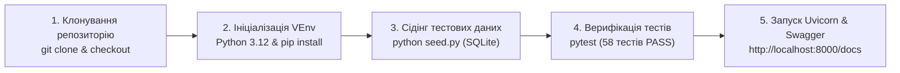

# Пакет передачі знань (Handover Package)

**Проєкт:** RunTracker  
**Версія системи:** 1.0.0  
**Цільова аудиторія:** Команда супроводу, нові розробники (Onboarding Engineers), Tech Lead, DevOps  
**Дата підготовки:** 2026-11-15  
**Стан готовності системи:** **Always Ready to Handover (PASS)**  

---

## 1. Реєстр документів архітектурного паспорта

Усі знання про систему відчужені від окремих осіб і формалізовані у текстовому форматі Markdown (Documentation as Code):

| Документ | Призначення | Власник (Owner) | Цикл перегляду | Статус актуальності |
|---|---|---|---|---|
| [README.md](../README.md) | Швидкий старт, огляд можливостей, API-довідник | Documentation Governance Manager | 90 днів | **Актуальний (PASS)** |
| [docs/sdd.md](sdd.md) | System Design Document (C4, сервіси, ER-схема, API) | Lead Software Architect | 180 днів | **Актуальний (PASS)** |
| [docs/isd.md](isd.md) | Infrastructure Spec (Dev/Prod, CI/CD, RTO/RPO) | DevOps / SRE Lead | 90 днів | **Актуальний (PASS)** |
| [docs/architecture/adr/](architecture/adr/README.md) | Реєстр архітектурних рішень (ADR-0001, ADR-0002) | Lead Software Architect | 180 днів | **Актуальний (PASS)** |
| [docs/maintenance.md](maintenance.md) | Регламент перегляду та правило «Код = Документ» | Documentation Governance Manager | 90 днів | **Актуальний (PASS)** |

---

## 2. Інструкція онбордингу нового розробника (Onboarding Playbook)

Чіткий 5-кроковий маршрут введення нового інженера в команду (Zero to First PR за 15 хвилин):



### Покрокові команди:

1. **Крок 1: Отримання вихідного коду**
   ```bash
   git clone https://github.com/runtracker/runtracker.git
   cd runtracker
   ```
2. **Крок 2: Налаштування віртуального оточення та встановлення залежностей**
   ```bash
   cd backend
   python -m venv .venv
   source .venv/bin/activate    # Linux/macOS
   # .venv\Scripts\activate     # Windows
   pip install -r requirements.txt
   ```
3. **Крок 3: Ініціалізація бази даних та наповнення демо-даними**
   ```bash
   python seed.py
   # Створюється runtracker.db з 1 бігуном, 28 тренуваннями та 3 парами кросівок
   ```
4. **Крок 4: Верифікація тестового покриття та воріт якості**
   ```bash
   pytest
   # Очікуваний результат: 58 passed, 0 failures
   radon cc -s -n C app/
   # Очікуваний результат: жодної функції з CC > 10
   ```
5. **Крок 5: Запуск локального сервера розробки**
   ```bash
   uvicorn app.main:app --reload --port 8000
   ```
   Перевірте доступність інтерфейсу: <http://127.0.0.1:8000> та Swagger API: <http://127.0.0.1:8000/docs>.

---

## 3. Декларація Bus Factor та усунення Single Points of Knowledge (SPOK)

### 3.1. Оцінка поточного Bus Factor
- **Поточний показник Bus Factor системи:** **$BF = 1$** (критичний ризик).
- **Пояснення:** Проєкт розроблявся одним студентом-автором. Раптова втрата ключового розробника («фактор автобуса») раніше створювала загрозу зупинки розвитку окремих складних підсистем.

### 3.2. Матриця «темних зон» та компонентів ризику

| Компонент / Підсистема | Поточний Bus Factor | Носій знань | Рівень критичності | Виявлені ризики втрати знань |
|---|---|---|---|---|
| **Модуль кардіозон та темпу** (`app.services.heart_rate`, `pace`) | 1 | Автор проєкту | **Високий** | Складні формули Танаки, Карвонена та експоненційного розрахунку Рігеля ($T_2 = T_1 \times (D_2/D_1)^{1.06}$). При відсутності автора важко верифікувати граничні умови. |
| **Калькулятор зносу взуття** (`app.services.gear`) | 1 | Автор проєкту | **Середній** | Логіка зміни 4 статусів (`ok → warning → critical → replace`) та розрахунок коефіцієнтів зносу. |
| **Модуль Privacy by Design** (`app.privacy.*`) | 1 | Автор проєкту | **Критичний** | Тонкощі санітизації PII, фільтрація у логах через Middleware, робота з GDPR-згодою. Помилка може призвести до штрафів за витік персональних даних. |
| **Конфігурація CI/CD та Hotspots** (`.github/workflows/*`, `scripts/`) | 1 | Автор проєкту | **Середній** | Автоматичний розрахунок метрик Churn, Radon CC, Halstead та скрипти аналізу гарячих точок. |

### 3.3. Інженерний план підвищення Bus Factor ($BF \ge 2$)

Для повної ліквідації одиничних точок відмови у знаннях (Single Points of Failure) запроваджуються такі контрзаходи:

1. **Паспортизація знань (Documentation as Code):**
   - Усі архітектурні інваріанти зафіксовані в [sdd.md](sdd.md), [isd.md](isd.md) та ADR. Новий інженер отримує повну картину системи без потреби усного переказу.
2. **Комплексне автотестування (Living Specifications):**
   - 58 юніт-, інтеграційних та смоук-тестів документують очікувану поведінку системи на рівні виконуваного коду.
3. **Парне рецензування коду (Peer Reviewing & Knowledge Sharing):**
   - Жоден коміт у `main` не дозволяється без аппруву другого члена команди;
   - Ротація завдань: задачі з GDPR та аналітики передаються іншим інженерам під супервізією.
4. **Автоматизований Quality Gate:**
   - Pre-commit hooks блокують застарівання коду (Radon CC $\le 10$, Gitleaks), знімаючи суб'єктивний фактор контролю якості.

---

## 4. Фінальний інженерний вердикт

> ### СТАТУС СИСТЕМИ: **ALWAYS READY TO HANDOVER**
> 
> **Обґрунтування:**  
> 1. Наявний повний комплект паспортизації: SDD, ISD, ADR, Maintenance Regime.  
> 2. Контрольний краш-тест деградації документації успішно пройдено (FAIL $\to$ PASS): регламент відновлення актуальності довів свою працездатність.  
> 3. Тестовий набір повністю зелений (58/58 тестів PASS, $CC \le 10$, покриття $\ge 80\%$).  
> 4. Плейбук онбордингу дозволяє розгорнути робоче оточення менш ніж за 15 хвилин без допомоги автора проєкту.  
> 
> Система повністю готова до передачі будь-якій зовнішній команді супроводу або новим розробникам.
