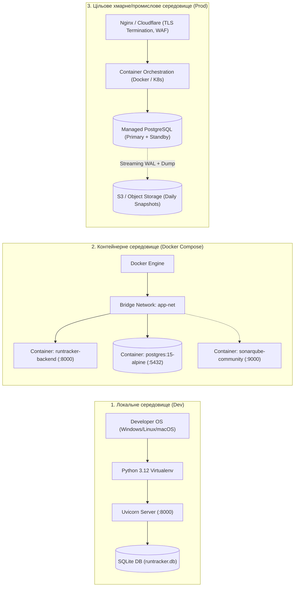

# Специфікація інфраструктури (Infrastructure Specification Document — ISD)
**Проєкт:** RunTracker  
**Версія:** 1.0.0  
**Статус:** Базовий (Accepted)  
**Дата затвердження:** 2026-11-15  
**Власник:** DevOps & SRE група (DevOps Engineer)

---

## 1. Топологія розгортання системи

Система RunTracker підтримує три рівні розгортання залежно від призначення середовища:



---

## 2. Конфігурація робочих середовищ та змінні

Усі параметри конфігурації передаються через змінні оточення (12-Factor App) за стандартом `.env.example`. Збереження секретних ключів у системі контролю версій суворо заборонено.

### Матриця змінних середовища

| Назва змінної | Призначення | Dev (значення) | Test (значення) | Prod (шаблон) |
|---|---|---|---|---|
| `APP_ENV` | Режим оточення | `development` | `testing` | `production` |
| `DEBUG` | Режим налагодження FastAPI | `True` | `False` | `False` |
| `DATABASE_URL` | Підключення до бази даних | `sqlite:///./runtracker.db` | `sqlite:///./test_runtracker.db` | `postgresql+psycopg2://user:pass@db:5432/runtracker` |
| `CORS_ORIGINS` | Дозволені джерела запитів | `["*"]` | `["*"]` | `["https://runtracker.ua"]` |
| `LOG_LEVEL` | Рівень деталізації логів | `DEBUG` | `INFO` | `INFO` |
| `ENABLE_PRIVACY_LOGGING`| Фільтрація PII в запитах | `true` | `true` | `true` |
| `WEATHER_API_URL` | Зовнішній провайдер погоди | `https://api.open-meteo.com` | `mock` | `https://api.open-meteo.com` |
| `SECRET_KEY` | Ключ підпису сесій / токенів | `dev-insecure-key-32chars` | `test-secret-key-32chars` | `${PROD_SECRET_KEY}` |

---

## 3. Сховища даних та робочі середовища

Компоненти, описані у [Документі проєктування (SDD)](sdd.md#3-декомпозиція-та-опис-компонентів), використовують такі рівні збереження даних:

### 3.1. SQLite 3 (Dev / Test)
- **Файл:** `backend/runtracker.db` або `backend/test_runtracker.db`.
- **Характеристики:** Вбудована СУБД, нульова залежність від зовнішніх демонів, режим Journaling (WAL).
- **Призначення:** Швидкий локальний старт розробника без підняття Docker, ізольовані юніт- та інтеграційні тести.

### 3.2. PostgreSQL 15+ (Production / Staging / Compose)
- **Контейнер:** `postgres:15-alpine` з мапінгом порту `5432:5432`.
- **Том (Volume):** `postgres_data:/var/lib/postgresql/data` (збереження даних при перезапуску).
- **Конфігурація пулу з'єднань SQLAlchemy:**
  - `pool_size`: 10 з'єднань;
  - `max_overflow`: 20 додаткових з'єднань;
  - `pool_timeout`: 30 секунд;
  - `pool_recycle`: 1800 секунд (для запобігання обривам з'єднань).

---

## 4. Конвеєр неперервної інтеграції (CI/CD Quality Gates)

Конвеєр побудований на платформі **GitHub Actions** на базі напрацювань ЛР№1–7 і складається з двох автоматизованих workflows:

### 4.1. `sonar.yml` — Перевірка коду та ворота якості (Quality Gate)
- **Тригери запуску:** `push` та `pull_request` у гілку `main`.
- **Стадії конвеєра:**
  1. `Checkout`: клонування коду з повною історією (`fetch-depth: 0`).
  2. `Setup Python`: ініціалізація інтерпретатора Python 3.12.
  3. `Install Dependencies`: інсталяція бібліотек із `backend/requirements.txt`.
  4. `Run Pytest & Coverage`: виконання тестів та формування XML-звіту покриття:
     ```bash
     pytest --cov=app --cov-report=xml:coverage.xml
     ```
  5. `SonarCloud Scan`: статичний аналіз коду на вразливості, code smells, дублювання та перевірка Quality Gate.
- **Порогові критерії воріт якості (Quality Gate Thresholds):**
  - Покриття новим кодом: $\ge 80\%$;
  - Рівень дублювання коду: $\le 3.0\%$;
  - Кількість блокуючих та критичних вразливостей: $0$;
  - Відсутність секретів у комітах (Gitleaks).

### 4.2. `hotspots.yml` — Аналіз архітектурної складності та дрейфу (Hotspots Audit)
- **Тригери запуску:** Будь-який `push` та `pull_request`.
- **Стадії конвеєра:**
  1. Обчислення цикломатичної складності за допомогою `radon cc -j backend/app`.
  2. Обчислення метрик Холстеда за допомогою `radon hal -j backend/app`.
  3. Розрахунок Code Churn за 90 днів:
     ```bash
     git log --since="90 days ago" --name-only | grep -v '^$' | sort | uniq -c
     ```
  4. Формування матриці гарячих точок (`Hotspots Matrix`) скриптом `scripts/hotspots.py`.
  5. Збереження артефакту звіту `hotspots-report`.

---

## 5. Моніторинг, резервне копіювання та відновлення (DRP)

### 5.1. Моніторинг працездатності (Health Check & Liveness)
- **Healthcheck URL:** `GET /api/health`
- **Періодичність опитування:** кожні 30 секунд.
- **Очікувана відповідь:** HTTP 200 `{"status": "ok", "version": "1.0.0"}`.
- **Критерій деградації (Incident Trigger):** 3 поспіль запити з таймаутом > 3с або HTTP 5xx.

### 5.2. Резервне копіювання (Backup Policy)
- **База даних PostgreSQL:**
  - Щоденний повний дампи бази: `pg_dump -Fc runtracker > /backups/runtracker_$(date +%F).dump`;
  - Архівація журналів випереджувального запису (Write-Ahead Logging / WAL) кожні 15 хвилин;
  - Зберігання щоденних бекапів: 30 днів (з ротацією на S3-сумісне сховище).
- **Локальна база SQLite (Dev):**
  - Реплікація файлу `runtracker.db` перед виконанням міграцій.

### 5.3. Цільові метрики аварійного відновлення (Target RTO & RPO)

| Метрика | Цільове значення | Інженерне обґрунтування |
|---|---|---|
| **RTO (Recovery Time Objective)** | **$\le 15$ хвилин** | Максимально допустимий час простою сервісу. Забезпечується автоматичним розгортанням контейнера з актуального Docker-образу та підключенням до існуючого storage volume або відновленням з останнього дампу. |
| **RPO (Recovery Point Objective)** | **$\le 1$ година** | Максимально допустимий обсяг втрати даних бігових тренувань. Забезпечується періодичною фіксацією транзакцій та погодинним архівуванням WAL-файлів PostgreSQL. |

---

## 6. Зв'язок компонентів з SDD
- Контейнери бази даних обслуговують сутності, зафіксовані в [sdd.md (Модель даних)](sdd.md#4-модель-даних-entity-relationship-model).
- Серверні контейнери API реалізують маршрути [sdd.md (API-контракти)](sdd.md#5-реєстр-api-контрактів).
- Усі зміни інфраструктури регламентуються документом [maintenance.md](maintenance.md).
