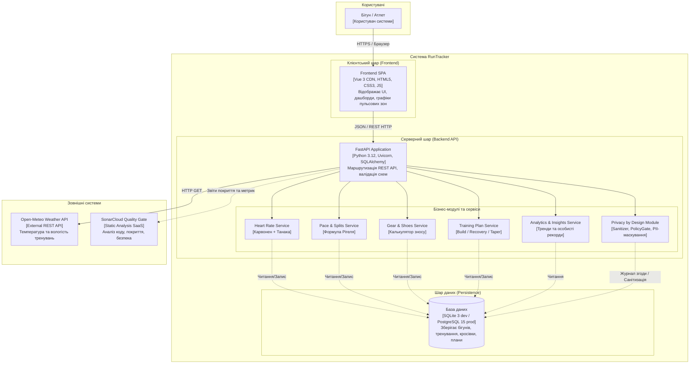
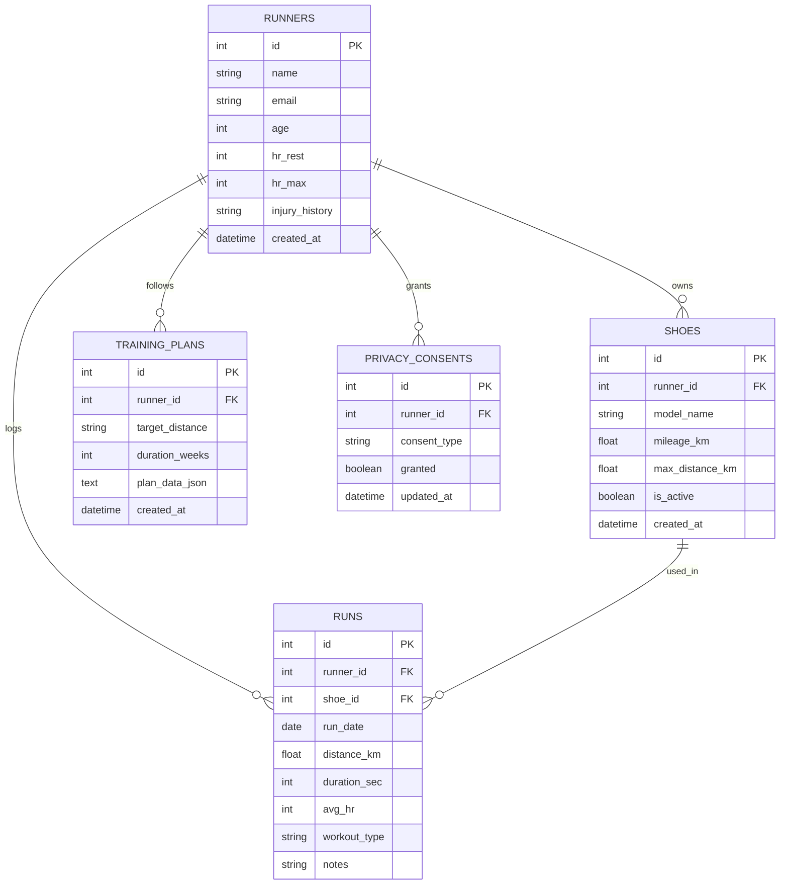

# Документ проєктування системи (System Design Document — SDD)
**Проєкт:** RunTracker  
**Версія:** 1.0.0  
**Статус:** Базовий (Accepted)  
**Дата затвердження:** 2026-11-15  
**Власник:** Архітектурна група RunTracker (System Architect)

---

## 1. Призначення та межі системи

**RunTracker** — це вебзастосунок для бігунів-аматорів та напівпрофесіоналів, призначений для:
- індивідуального планування тренувальних циклів (підготовка до 5 км, 10 км, півмарафону);
- реєстрації щоденних бігових тренувань з автоматичним розрахунком темпу та сплітів;
- аналізу кардіонавантаження за 5 зонами ЧСС Карвонена та формулою максимального пульсу Танаки;
- відстеження ресурсу та зносу бігового взуття з багаторівневою нотифікацією (`ok → warning → critical → replace`);
- забезпечення комплаєнсу з регламентом GDPR (Privacy by Design): маскування PII у логах, санітизація, керування згодою, вивантаження персональних даних.

Деталі конфігурації середовищ виконання наведені в [Специфікації інфраструктури (ISD)](isd.md).

---

## 2. C4-модель: Діаграма контейнерів (C4 Container Diagram)

Діаграма відображає високорівневу структуру компонентів системи RunTracker, протоколи зв'язку та зовнішні інтеграції.

---

## 3. Декомпозиція та опис компонентів

Кожен компонент має фіксовану зону відповідальності, явні залежності та відображення на інфраструктурні ресурси, описані в [isd.md](isd.md#3-сховища-даних-та-робочі-середовища).

### 3.1. Модуль бігунів (`app.routers.runners` & `app.services.heart_rate`)
- **Відповідальність:** Керування обліковими записами спортсменів, збереження фізіологічних показників (вік, пульс спокою `hr_rest`, максимальний пульс `hr_max`), розрахунок персональних зон інтенсивності.
- **Математична модель:**
  - Оцінка максимального пульсу: формула Танаки: $HR_{max} = 208 - (0.7 \times Age)$.
  - 5 пульсових зон: метод Карвонена з урахуванням резерву серця: $HR_{target} = HR_{rest} + \% \times (HR_{max} - HR_{rest})$.
- **Залежності:** `app.database.get_db`, `app.models.Runner`, `app.schemas.RunnerCreate`.
- **Інфраструктурна прив'язка:** Зберігання в таблиці `runners` ([isd.md](isd.md#3-сховища-даних-та-робочі-середовища)).

### 3.2. Модуль тренувань (`app.routers.runs` & `app.services.pace` / `analytics`)
- **Відповідальність:** Реєстрація фактів бігових занять (дистанція, тривалість, пульс, тип), розрахунок середнього темпу (хв/км), обчислення щотижневого кілометражу, виявлення особистих рекордів (PB).
- **Математична модель:** Прогнозування часу на цільовій дистанції за формулою Пітера Рігеля: $T_2 = T_1 \times (D_2 / D_1)^{1.06}$.
- **Залежності:** `app.services.pace`, `app.services.gear`, `app.models.Run`, `app.models.Shoe`.
- **Інфраструктурна прив'язка:** Таблиця `runs` із foreign key на `runners` та `shoes`.

### 3.3. Модуль екіпірування (`app.routers.shoes` & `app.services.gear`)
- **Відповідальність:** Облік пар бігових кросівок, калькуляція накопиченого кілометражу, прогнозування потреби в заміні пари.
- **Статусний автомат зносу:**
  - `ok` — пробіг < 70% ліміту;
  - `warning` — пробіг 70–90% ліміту (рекомендовано придбати заміну);
  - `critical` — пробіг 90–100% ліміту (високий ризик травмування зв'язок);
  - `replace` — пробіг >= 100% ліміту (взуття непридатне для бігу).
- **Залежності:** `app.models.Shoe`, `app.schemas.ShoeCreate`.

### 3.4. Модуль планів підготовки (`app.routers.plans` & `app.services.plans`)
- **Відповідальність:** Автоматична побудова циклічних тренувальних програм на дистанції 5 км, 10 км та 21.1 км з розподілом на три фази:
  - *Build* (нарощування щотижневого обсягу);
  - *Recovery* (відновлювальний розвантажувальний тиждень);
  - *Taper* (передзмагальне звуження обсягу для суперкомпенсації).
- **Залежності:** `app.models.TrainingPlan`, `app.services.plans.generate_plan`.

### 3.5. Модуль приватності та безпеки (`app.privacy.*` & `app.routers.privacy`)
- **Відповідальність:** Реалізація вимог GDPR Privacy by Design (ЛР№4):
  - `Sanitizer`: видалення PII (email, телефон, імена) перед експортом;
  - `PolicyGate`: перевірка прав на обробку медичних/фізіологічних даних;
  - `PrivacyLoggingMiddleware`: фільтрація тіла HTTP-запитів і заголовків авторизації у системних логах;
  - Експорт персонального дампа (GDPR Right to Data Portability) та знеособлення профілю (Right to be Forgotten).
- **Залежності:** `app.privacy.service.PrivacyService`, `app.models.PrivacyConsent`.

---

## 4. Модель даних (Entity-Relationship Model)

Схема бази даних реалізована за допомогою SQLAlchemy 2.0 ORM. Підтримується повна сумісність між SQLite та PostgreSQL.

---

## 5. Реєстр API-контрактів

Усі ендпоїнти доступні через інтерактивну OpenAPI-документацію за адресою `/docs` (Swagger UI).

| Метод | URI ендпоінта | Призначення | Тіло запиту / Параметри | Модель відповіді |
|---|---|---|---|---|
| `GET` | `/api/health` | Перевірка працездатності сервісу | Немає | `{"status": "ok", "version": "1.0.0"}` |
| `POST` | `/api/runners` | Створення профілю бігуна | `RunnerCreate` (JSON) | `RunnerOut` (HTTP 201) |
| `GET` | `/api/runners` | Отримання переліку бігунів | Query: `limit`, `offset` | `list[RunnerOut]` |
| `GET` | `/api/runners/{id}/zones` | Розрахунок пульсових зон Карвонена | Path: `id` | `HeartRateZonesOut` |
| `POST` | `/api/runs` | Додавання виконаного тренування | `RunCreate` (JSON) | `RunOut` (HTTP 201) |
| `GET` | `/api/runs` | Історія тренувань бігуна | Query: `runner_id` | `list[RunOut]` |
| `GET` | `/api/runs/{id}/details` | Детальна інформація та темп | Path: `id` | `RunDetailsOut` |
| `GET` | `/api/runs/summary/weekly` | Тижневе зведення кілометражу | Query: `runner_id` | `list[WeeklySummary]` |
| `GET` | `/api/runs/summary/insights` | Аналітичні інсайти та рекорди | Query: `runner_id` | `InsightsOut` |
| `POST` | `/api/shoes` | Додавання нової пари кросівок | `ShoeCreate` (JSON) | `ShoeOut` (HTTP 201) |
| `GET` | `/api/shoes` | Перелік екіпірування бігуна | Query: `runner_id` | `list[ShoeOut]` |
| `GET` | `/api/shoes/{id}/status` | Статус зносу кросівок | Path: `id` | `ShoeStatusOut` |
| `POST` | `/api/plans` | Генерація потижневого плану | `PlanRequest` (JSON) | `PlanOut` (HTTP 201) |
| `GET` | `/api/plans/race/forecast` | Прогноз фінішного часу Рігеля | Query: `dist_km`, `time_sec` | `ForecastOut` |
| `POST` | `/api/privacy/consent` | Фіксація згоди на обробку PII | `ConsentCreate` (JSON) | `ConsentOut` |
| `GET` | `/api/privacy/export/{runner_id}`| GDPR Data Portability дамп | Path: `runner_id` | `PrivacyExportOut` |
| `POST` | `/api/privacy/anonymize/{runner_id}`| GDPR знеособлення даних | Path: `runner_id` | `{"status": "anonymized"}` |

---

## 6. Інваріанти якості та архітектурні обмеження
1. **Низька цикломатична складність:** жодна функція бізнес-логіки не повинна перевищувати $CC \le 10$ (контролюється pre-commit hook та Radon у CI).
2. **Безпека секретів:** жорстко закодовані токени та паролі неприпустимі у репозиторії (контролюється `gitleaks`).
3. **Documentation-Driven Architecture:** будь-яке розширення ендпоінтів або моделей даних вимагає синхронного оновлення даного SDD згідно з регламентом [maintenance.md](maintenance.md).
